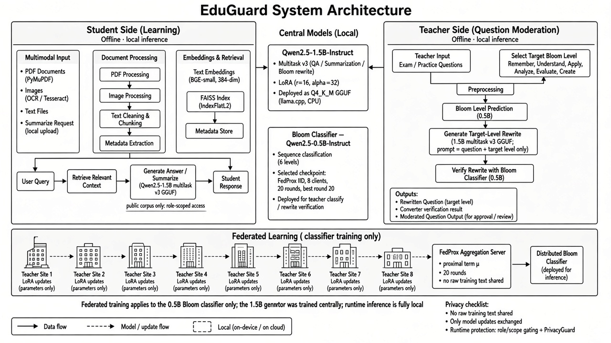
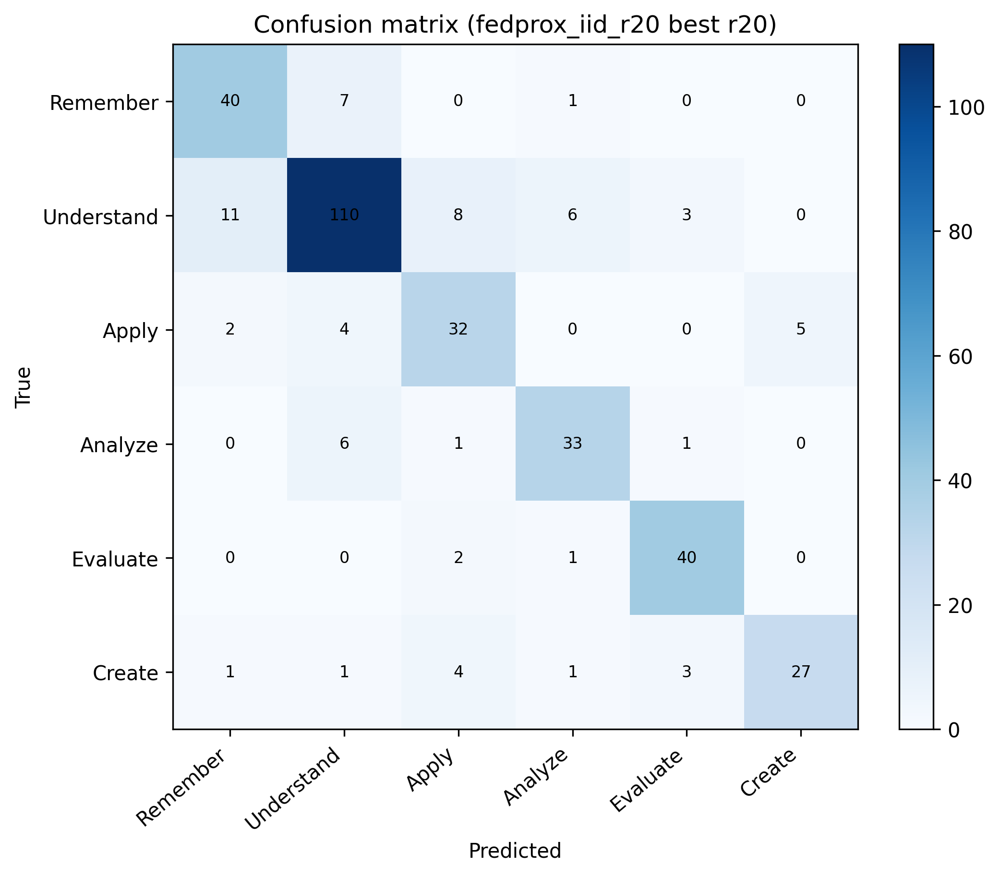
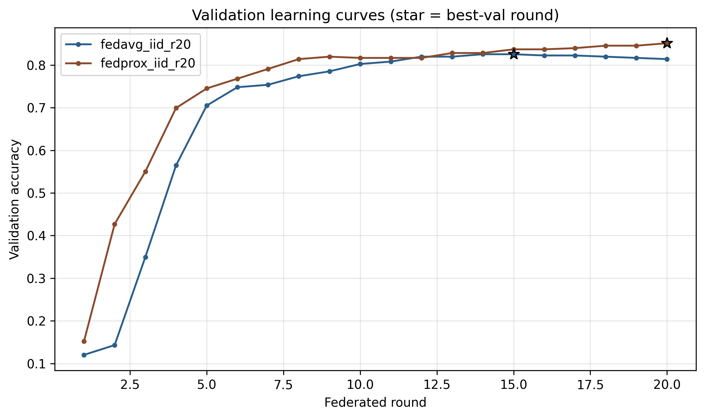
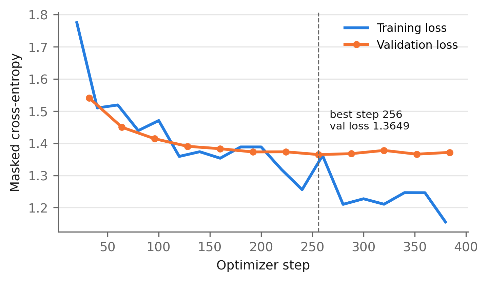
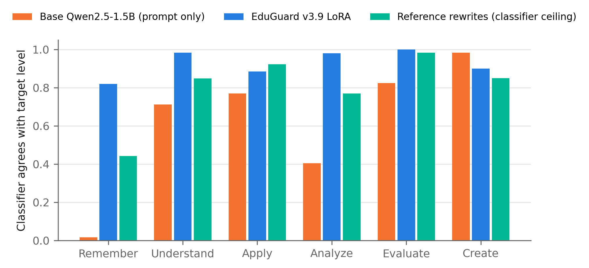
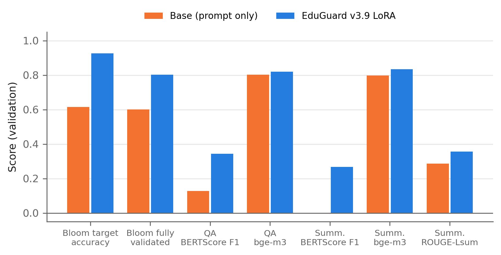
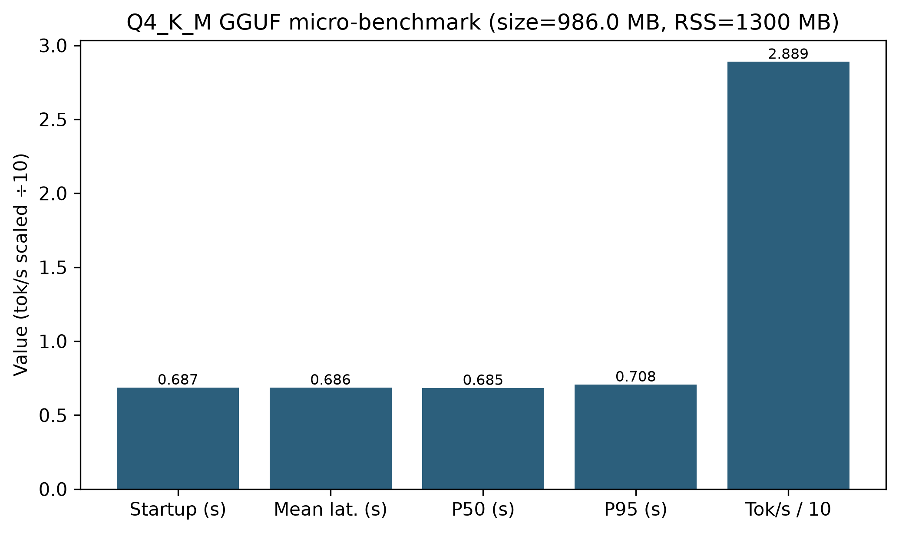
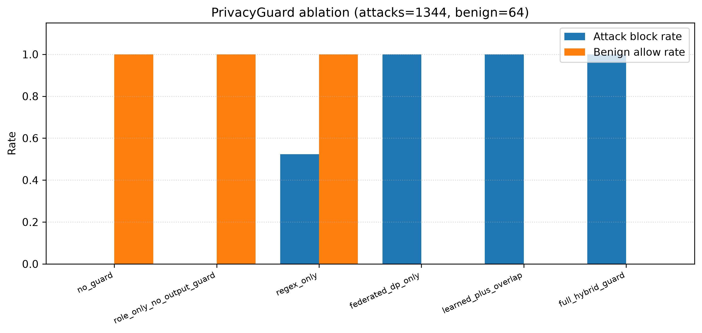

# EduGuard: A Local, Privacy-Aware Small-Language-Model System for Bloom-Aligned Question Moderation, Closed-Book Question Answering and Summarization

**Author One**^a,\*, **Author Two**^a, **Supervisor Name**^a

^a Department, University, City, Country
\* Corresponding author. E-mail: corresponding.author@university.edu

---

## Abstract

Teachers who moderate examination questions handle material that must not leave the institution, yet most assistive language-model tools are cloud services. We present **EduGuard**, an offline system that runs entirely on institutional hardware. It combines four parts:

- a federated 0.5B-parameter Bloom-taxonomy classifier;
- a single 1.5B-parameter multitask generator (Bloom-targeted question rewriting, closed-book academic question answering and summarization), fine-tuned with LoRA;
- role-separated retrieval;
- an output-screening guard, PrivacyGuard.

**Classifier.** It is trained with FedProx across eight simulated teacher sites, so raw questions are never pooled. It reaches 0.806 accuracy on the held-out Figshare Bloom test set (N = 350), against 0.831 for the same model trained centrally.

**Generator.** We built the rewrite corpus from 600 corrected course questions, with a final correction that turns Remember-level targets into single-recall questions. On the held-out **test** split (N = 351 rewrites, evaluated once), an independent classifier confirms the requested Bloom level in 92.6% of rewrites, against 64.4% for the prompt-only base model. A blind 7B judge confirms 76.1% [71.5, 80.6], against 61.3%. Remember-level accuracy rises from 3.1% to 85.9%, and fully validated rewrites (correct level, topic preserved, not a copy, well-formed) rise from 61.8% to 80.3%. Test results match validation within 2 points, so model selection did not overfit. For context, two human experts judged 60–73% of questions generated by GPT-4, GPT-3.5, Llama-2-70B and Mistral-7B to match the requested level in a published study. That study used a different task and different judges, so the comparison is indicative only.

**QA and summarization.** Fine-tuning makes closed-book answers concise and reference-like (rescaled BERTScore F1 0.126 → 0.341 on test; median length 148 → 36 words), but a calibrated 7B judge rates fewer of them fully correct (0.728 against 0.973 for the more verbose base model). For summarization, BERTScore F1 rises from −0.009 to 0.265 and ROUGE-Lsum from 0.282 to 0.361, and median length falls from 281 to 79 words (reference: 86).

**Deployment and privacy.** A 4-bit GGUF export of the generator (986 MB) runs entirely on CPU, with median latencies of 5.4 s per rewrite and 3.5 s per answer. Its task quality is statistically indistinguishable from full precision, but it falls into repetition loops on more summaries. PrivacyGuard blocks all 104 attacks in its benchmark but currently also blocks benign student requests, and we report this trade-off openly.

We do not claim formal differential privacy. Its utility collapsed in our experiments and it is not deployed.

**Keywords:** Bloom's taxonomy; question moderation; federated learning; LoRA; small language models; privacy-preserving education; question rewriting; offline AI

---

## Highlights

- An offline, on-premise assistant for teachers' Bloom-level exam-question moderation.
- A Bloom classifier trained with FedProx comes within 2.6 points of centralized training.
- One 1.5B LoRA model handles rewriting, closed-book QA and summarization.
- On held-out test data, rewrites hit the requested Bloom level 92.6% of the time (base: 64.4%).
- A 1.5B local model reaches 76.1% judged level adherence; published LLM rates are 60–73%.
- Privacy limits are reported openly: no DP claim, and the guard over-blocks.

*(Elsevier highlights: 3–5 bullets, ≤85 characters each.)*

---

## 1. Introduction

Bloom's taxonomy [1], in its revised six-level form (Remember, Understand, Apply, Analyze, Evaluate, Create) [2], is the standard tool for balancing the cognitive demand of an examination. In practice, moderation means two repeated tasks. A teacher or moderation panel checks the level each question actually tests, and rewrites questions that miss the intended level. Both tasks take time and are inconsistent across raters, so they are natural candidates for language-model assistance.

Unreleased examination questions are confidential. Sending them to a commercial cloud model can breach institutional policy and creates a leak risk before the exam is sat. Data-protection rules also cover student questions and uploaded course material. An assistant for this setting must therefore meet four requirements:

1. **Locality.** Inference runs on institutional hardware without network access.
2. **Collaboration without pooling.** Schools or departments can improve a shared model without sending their question banks to a central server.
3. **Role separation.** Students must not be able to retrieve or reconstruct protected teacher material.
4. **Usefulness at small scale.** The models must run on commodity hardware, which rules out frontier-scale models.

This paper presents **EduGuard**, a system designed around these four requirements. Our contributions are:

- **C1. A deployable architecture.** It separates a small Bloom *classifier* (Qwen2.5-0.5B, trained with federated learning) from a single multitask *generator* (Qwen2.5-1.5B with LoRA). The generator rewrites questions to a target Bloom level, answers academic questions without a supporting passage, and summarizes academic text. Everything runs offline, and the generator also ships as a 4-bit GGUF file for CPU inference.
- **C2. A classify–rewrite–verify workflow.** The classifier checks every rewrite before a teacher sees it. We also give an evaluation protocol that scores model rewrites and reference rewrites *with the same instruments*, so measurement ceilings are visible.
- **C3. A data-correction study.** It shows that the Remember level, the weakest level of a fine-tuned rewriter (26.2% classifier agreement), is limited mainly by inconsistent reference targets. Making the 249 affected training targets single-recall questions raises Remember accuracy to 82.0% without any change to the model or optimizer.
- **C4. An honest privacy assessment.** It covers what federated training, role-separated retrieval and output screening each protect against, where they fail, and which claims we deliberately do not make: no formal differential privacy (DP), and no cryptographic guarantees.

Section 2 reviews related work. Section 3 describes the architecture. Section 4 covers data and methods. Section 5 covers the experimental setup. Section 6 reports results, and Sections 7 and 8 discuss limitations and conclude.

## 2. Related work

### 2.1 Small and local language models in education

Task-specific small language models (SLMs) can match much larger cloud models on narrow educational tasks while staying locally hosted. Examples include assessment design [9], short-answer grading on CPUs [10], and on-device or school-level deployment frameworks [11, 12]. These studies also caution that in-domain gains do not automatically transfer, and that LLM-as-judge scores can disagree with expert ratings [9, 10]. Local deployment is a governance property and not, by itself, a privacy proof [12, 13]. EduGuard follows this line, using Qwen2.5 models [3] at 0.5B and 1.5B parameters.

### 2.2 Bloom-level classification and question generation

Automatic Bloom classification has progressed from rule-based and TF-IDF features [19, 23] to transformer classifiers [18, 20] and prompted LLMs [21, 22]. Reported in-dataset scores are high but fall sharply across datasets. Mohammed and Omar reach a weighted F1 of 0.837–0.897 with TF-POS-IDF and word2vec features [19]. BloomNet reaches 87.5% accuracy on its own 600-question dataset but 70.4% on a second dataset, against 82.0% and 68.7% for RoBERTa [20].

On generation, LLMs can produce questions at a requested Bloom level [25–27, 39], and answers can be graded automatically [28]. Adherence to the requested level is far from solved even for frontier models. In the largest expert evaluation we found (2,550 questions, two experts), the share of high-quality questions judged to be at the requested level was 70.0% for GPT-4, 73.4% for GPT-3.5, 61.7% for Llama-2-70B, and 60.0% for Mistral-7B and PaLM 2 [27]. In a separate study of GPT-4 Turbo, teachers agreed with the intended level for 65–69% of Remember, Understand and Create questions, and Analyze questions were often judged to be Evaluate [39].

These works usually generate *new* items from a topic with prompted cloud models. EduGuard instead *rewrites an existing teacher question* to a target level while keeping its topic, which is what a moderation workflow needs. It does so with a fine-tuned 1.5B model on local hardware, and checks each output with an independent classifier. Small task-specific models can outperform much larger prompted ones on narrow tasks: a fine-tuned 770M T5 model beat few-shot 540B PaLM on a benchmark [42]. EduGuard tests this for Bloom-level rewriting.

### 2.3 Retrieval-augmented generation

Retrieval-augmented generation (RAG) [14] grounds answers in retrieved text and has been used in campus deployments [13] and in Bloom-structured assessment [15]. None of these shows that retrieval by itself prevents leaks of confidential exam wording. EduGuard keeps separate public and protected FAISS indexes [16] with BGE-family embeddings [17], and enforces role gating independently of retrieval scores.

### 2.4 Parameter-efficient and federated fine-tuning

LoRA [4] trains low-rank adapters while the base model stays frozen. Compared with full fine-tuning, LoRA learns less of a new domain but forgets less of the base model's other abilities [41]. QLoRA [29] adds 4-bit quantization of the base model during training. Fine-tuning has known side effects on knowledge: examples that introduce facts the model does not already know are learned slowly and increase its tendency to hallucinate [40], and continual fine-tuning of 1–7B models causes catastrophic forgetting of earlier abilities [43]. Federated learning (FL) trains a shared model from client updates without centralizing data. FedAvg [5, 30] averages client weights, and FedProx [6] adds a proximal term that stabilizes heterogeneous clients. Federated LoRA reduces communication further, and client-adaptive variants exist [31, 32]. Federated optimization alone is *not* a privacy guarantee: model updates can leak information, and formal protection requires DP [8] or secure aggregation [7, 33].

### 2.5 Gap

Prior work treats local SLMs, Bloom classification, Bloom-targeted generation, RAG and FL separately. To our knowledge, no system combines them into an offline teacher-moderation tool, and few report evaluations that place model outputs next to the ceiling of their automatic judge. EduGuard addresses both. It does not propose a new learning algorithm or a formal privacy definition.

## 3. System architecture

**Figure 1.** EduGuard architecture. A teacher's question goes to the Bloom classifier (Qwen2.5-0.5B, FedProx-trained) and, on request, to the multitask generator (Qwen2.5-1.5B + LoRA). The generator's rewrite is classified again before it is shown. Students reach only the public retrieval index, and every student-facing answer passes PrivacyGuard. All components run on one offline machine.

EduGuard is a FastAPI back end with a web front end. It has two roles, *teacher* and *student*, authenticated by access code. The design rule is that **no component sends data off the machine**: all models load from local disk, and the Hugging Face hub is forced into offline mode.

**Bloom classifier (teacher-only).** Qwen2.5-0.5B-Instruct with a six-way sequence-classification head and LoRA adapters, trained federatedly (Section 4.2). It labels each submitted question with a Bloom level and a confidence, and an uncertainty gate (threshold 0.40) flags low-confidence predictions for human attention. It loads only after a teacher authenticates.

**Multitask generator.** One Qwen2.5-1.5B-Instruct model with a single LoRA adapter serves three teacher-facing functions:

- *Target-level rewrite:* a question plus a target Bloom level in, a rewritten question out.
- *Closed-book academic QA:* a question in, a concise answer out, with no supporting passage.
- *Summarization:* academic text in, an abstractive summary out.

The source Bloom level is deliberately not a generator input. The model sees only the question and the target, so it cannot learn shortcuts from source–target pairs.

**Classify–rewrite–verify.** When a teacher asks for a rewrite, the v3.9 generator writes it with exactly the prompt format used in training. The teacher can check the rewrite's level with the Bloom classifier before accepting, editing or rejecting it. The teacher then accepts, edits or rejects the rewrite. For any classified question, the teacher can also *confirm or correct* the predicted Bloom level. That confirmed label is appended to a local label store on the same machine and becomes the site's training data for the next federated round (Section 4.2).

**Role-separated retrieval.** Each session keeps two FAISS [16] indexes with BGE embeddings [17]:

- a *public* index of study material;
- a *protected* index of teacher-only material, such as exam drafts.

Student queries are resolved against the public index only. A student query is also screened for semantic overlap with the protected index, and refused if it targets protected material. Passages are embedded with BGE-small-en-v1.5 [17].

**Answering only from uploaded notes.** When a user has uploaded material, answers must come from it. A question is answered only if the best-matching passage reaches a cosine similarity of 0.58. This threshold was calibrated on CSE, EEE, database and economics notes: on-topic questions scored at least 0.60 and off-topic ones at most 0.556. After generation, sentences whose content words are mostly absent from the retrieved passages are removed. If nothing supported remains, the user is told that the notes do not cover the question. Removing the notes restores general closed-book answering.

**Summarizing long documents.** One summary call yields about 80–100 words whatever the input length, the length the summaries were trained on, and reads at most about 8,000 characters. A single call therefore either truncated a long lecture PDF or compressed it to a few sentences. Uploads longer than about 600 words are instead summarized section by section:

1. The document's sentences are grouped, in order, into parts of about 600 words (more for very long documents), up to twelve parts. A new part starts at a slide or section heading found during ingestion.
2. Each part is summarized with the trained prompt. A part summary shorter than 25 words is retried once with a rewording prompt.
3. The part summaries are returned in document order under their headings.

A requested format ("5 bullet points", "3 sentences") is shared out along section boundaries, so no bullet mixes two topics. Summary length now grows with the document, at 10–11% of the source:

| Document length | Single call | Section by section | Processing time (CPU) |
|---:|---:|---:|---:|
| 1,151 words | 18 words | 132 words | 29 s |
| 4,722 words | first part only | 505 words | about 100 s |
| 9,109 words | first part only | 921 words | about 190 s |

On a four-topic test document, a single call covered only the first topic; section by section covered all four.

**PrivacyGuard.** Student-facing outputs pass a hybrid screen: regular-expression patterns, n-gram and span overlap with protected text, semantic-concept checks, and a learned risk score. Outputs that may reproduce protected material are withheld.

**Deployment.** The generator is exported to GGUF with Q4_K_M quantization and served on CPU with llama.cpp. The classifier stays in FP16 Hugging Face format, because dynamic INT8 quantization collapsed its accuracy in our tests.

## 4. Data and methods

### 4.1 Datasets

**Figshare Bloom (classifier).** This is a public dataset of questions labelled with a Bloom level, using fixed splits of 1,631/349/350 (train/validation/test). The training split is imbalanced: Understand 640, Remember 225, Evaluate 199, Apply 199, Analyze 192, Create 176.

**EduGuard multitask corpus (generator, version v3.9).** It is stored as one directory per task, and every file is pinned by SHA-256 in a dataset manifest.

**Table 1.** Multitask corpus composition.

| Task | Train | Validation | Test | Source |
|---|---:|---:|---:|---|
| Bloom rewrite | 2,735 | 341 | 351 | 600 corrected course questions × target levels |
| Closed-book QA | 1,172 | 146 | 147 | Academic QA on textbook-style content |
| Summarization | 1,172 | 146 | 147 | OpenStax textbook sections, original academic examples, lecture-slide text |

*Bloom rewrite.* The rewrite data comes from 600 course questions that were corrected and labelled in an audited cleaning pass. The pass fixed phantom references to missing figures, misaligned action verbs and duplicate items, and recorded every edit in a correction log. Each training row asks the model to rewrite a source question to one other Bloom level. Rows are either *direct* source→target pairs or *pivot* pairs that link two rewrites of the same question.

Reference rewrites were drafted with model assistance and then checked automatically for format, level and topic. They were **not** individually verified by human experts, and we state this as a limitation (Section 7). The splits are fixed at the source-question level, so a test question's rewrites never appear in training.

*Remember-level correction (v3.4 → v3.9).* An error analysis of the previous model (v3.8) found that Remember was the only weak level: 26.2% classifier agreement against more than 90% for most other levels. The cause was the reference targets themselves. Many asked the student to "define X *and* identify Y", or to "write the formula for…", and such compound or productive tasks read as Understand. We rewrote the **249** affected training targets as single-recall questions ("What is…", "State…", "Name…"). We kept every one that the evaluation classifier labelled Remember, and resolved eight duplicate targets by hand.

The validation and test files were kept **byte-identical** to the previous version, so the comparison before and after the correction is fair. Because the classifier was used as a filter during training-data construction, Section 7 discusses the risk that the model overfits to the classifier.

*Closed-book QA.* The model answers without a passage, which matches how teachers use it ("What is the role of ATP in muscle contraction?"). Answers are short, at a median of 31.5 words.

*Summarization.* Source texts range from short to very long. Generation limits are set from the longest training summary plus 25% headroom.

### 4.2 Federated Bloom classifier

**Model.** Qwen2.5-0.5B-Instruct with a six-way classification head. LoRA [4] uses rank 32, α = 64 and dropout 0.1, and the score head is trained as well. Inputs are capped at 256 tokens, and training uses class weights capped at 3.0 plus label smoothing of 0.05.

**Federated protocol.** The training set is split across **eight clients**, each standing in for one teacher site. Clients receive the current global adapter, train locally for 3 epochs (learning rate 1e-4, effective batch 16), and return **only the LoRA and score-head weights**. Questions never leave the client. The server aggregates the updates with FedAvg [5] or FedProx [6] (μ = 0.01). The model is selected on validation accuracy and reported once on the test set.

We ran IID partitions (stratified by level) for 5 and 20 rounds. We also ran Dirichlet non-IID label-skew partitions (α ∈ {0.1, 0.5, 1.0}) for 5 rounds, to study heterogeneity between sites. Every run logs its upload and download bytes.

**Deployment-side federated rounds.** At runtime the deployed classifier is frozen: it never trains on teacher requests. Unlabelled requests would only teach it to repeat its own mistakes, and per-request updates would expose the shared model to poisoning. Federated learning continues instead in deliberate, periodic rounds (for example once per term) over **teacher-confirmed labels**:

1. A coordinator creates one shared LoRA adapter on top of the deployed classifier (round 0, seeded) and distributes it to every site.
2. Each site with at least 30 confirmed labels covering at least two levels trains locally with FedProx, using class weights from its own labels, and exports only the adapter and score-head weights with a SHA-256 integrity hash.
3. The coordinator aggregates the bundles from at least two sites into a new global adapter.
4. The candidate is merged and evaluated on a held-out labelled split. It is promoted only if accuracy does not fall by more than one point; otherwise every site keeps the current classifier.

Question text and the exported training file never leave the site. This mechanism is implemented and tested end-to-end on simulated sites. Results from real multi-site rounds are future work (Section 8).

**Why the generator is not federated.** The private, teacher-owned data in this setting is *examination questions and their Bloom labels*, and that is exactly what the classifier learns from. The generator is trained only on public or synthetic material: open textbooks and model-assisted rewrites of a corrected public question set. When teachers use the generator, their questions are processed by local inference and never used for training. Federating the 1.5B generator would therefore add a large cost with no privacy gain: about 74 MB of adapter traffic per client per round, a GPU at every site, and well-known utility losses. Generative models also memorize training text more readily than classifiers, so federating it on real teacher data would need DP, which already failed on the much smaller classifier (Section 6.1). Federated learning is therefore applied only where private labelled data exists.

### 4.3 Multitask generator

**Model and adapter.** Qwen2.5-1.5B-Instruct [3] with one LoRA adapter (rank 16, α = 32, dropout 0.1) on all seven attention and MLP projections. That is about 18.5M trainable parameters (1.2% of the model) and a 74 MB adapter.

**Training.** Supervised fine-tuning on the three tasks together, in the Qwen chat template. The loss is computed **only on assistant tokens**: prompt tokens are masked, and a validator checks the masks on all 6,357 sequences before training. Hyperparameters:

- AdamW, learning rate 1e-4, cosine schedule, 3% warmup;
- effective batch size 16 (1 × 16 gradient accumulation);
- bf16;
- at most 2 epochs and a maximum sequence length of 8,192 tokens.

Validation loss is computed every 32 steps, with early stopping at patience 4 and best-checkpoint restoration. Training took 56 minutes on one NVIDIA RTX 4080 (16 GB).

**Task-specific system prompts.** Each task has a fixed system instruction:

- *Rewrite:* "rewrite the question to the target Bloom level, preserve the topic, output only the question".
- *QA:* "answer concisely without a supporting passage".
- *Summarization:* "summarize faithfully".

**Decoding and loop guard.** Decoding is greedy, with per-task token caps of 160 (rewrite), 192 (QA) and 1,104 (summarization). A small 1.5B model can fall into repetition loops on long summaries, so we add a *loop guard* at decoding time. Generation stops when either condition holds:

- the last 24 tokens repeat an earlier span verbatim; the output is then cut back to the last complete sentence;
- four consecutive sentences start with the same six words; only the first of them is kept.

The guard made no false cuts on 1,464 reference texts. On validation it triggered on 2 of 341 rewrites and 6 of 146 summaries.

**Why this training design, and not the alternatives.** Each choice follows from the deployment constraint (offline, CPU, one consumer GPU for training) or from a measured failure.

- *Fine-tuning rather than prompting.* The prompt-only base model with the same instructions copies 31–37% of questions and almost never produces Remember-level rewrites (1.6% validation, 3.1% test). Better prompting cannot fix a model that does not distinguish the levels, so supervised examples are needed.
- *LoRA rather than full fine-tuning.* Full fine-tuning of 1.54B parameters does not fit comfortably on a 16 GB GPU with 8k-token examples. It also forgets more of the base model's general ability [41], which matters because the same model must still answer and summarize. LoRA trains 1.2% of the weights, and its adapter (74 MB) can be swapped or retrained per institution.
- *Not QLoRA.* The 1.5B model trains in bf16 within memory, so 4-bit training would add quantization noise for no gain. Quantization is applied only after training, for CPU deployment (Section 6.9).
- *One multitask adapter rather than three task adapters.* A CPU deployment can keep only one generator in memory, and switching adapters per request adds latency. Joint training also stops the rewrite task from overwriting the model's answering and summarizing behaviour. The sampling mix (50% rewrite, 25% QA, 25% summarization) gives the primary moderation task half of every epoch.
- *Loss on assistant tokens only.* Learning to reproduce system prompts and inputs wastes capacity and can teach the model to echo its input, the base model's main failure.
- *1.5B rather than 0.5B, 3B or 7B.* 1.5B is the largest size that met our interactive CPU budget: 4–9 s per rewrite on a desktop CPU at 4-bit. 3B and 7B configurations are released but not evaluated (Section 8). We did not compare other model families; Qwen2.5 was chosen so the classifier and generator share one tokenizer and chat template.
- *Correcting data rather than adding data or parameters.* The v3.8 error analysis traced the weakest level to inconsistent targets, not to model capacity. Rewriting 249 targets, with everything else fixed, raised Remember accuracy by 56 points (Section 6.3).
- *Supervised fine-tuning only, no preference optimization (DPO/RLHF).* We have no preference pairs, and the rewrite task has a verifiable target (the requested level) that is checked at inference by the classifier.
- *Early stopping on validation loss.* After step 256, training loss kept falling but validation loss stopped improving, which is the onset of over-fitting. Training stopped and the best checkpoint was restored (Figure 4).

### 4.4 Evaluation protocol

All automatic judgments apply the **same instruments to model outputs and to the reference outputs**. Where the reference itself scores poorly, a low model score reflects the instrument's limit rather than a model failure.

**Bloom rewrite.**

- *Target accuracy:* agreement between the requested level and the label from a fixed, centrally trained 0.5B Bloom classifier, which is never updated during this study. We report per-level accuracy and macro-F1.
- *Topic preservation:* bge-m3 [37] cosine similarity between source and rewrite, above a threshold calibrated on reference pairs.
- *Near-copy rate:* ROUGE-L [35] between source and rewrite above a calibrated threshold.
- *Format validity:* a single well-formed question or instruction, with no answer or meta-commentary.
- *Fully validated rate:* the conjunction of all four checks above (target match at confidence ≥ 0.5, topic preserved, not a near-copy, format valid).
- *Agreement with the reference rewrite* for the same target: ROUGE-L, and BERTScore F1 [36] with roberta-large, layer 17 and baseline rescaling.

**Closed-book QA.** bge-m3 similarity to the reference answer, BERTScore F1, and ROUGE-L with Markdown removed and the output cut to the reference length, so that long answers are not rewarded for recall alone. SQuAD exact match and token F1 [34] are not used as primary metrics, because a closed-book free-form answer rarely matches the reference string.

**Summarization.** ROUGE-1/2/L and summary-level ROUGE-Lsum [35], bge-m3 similarity, and BERTScore F1 (inputs truncated at 512 tokens). We also report length against the reference.

**LLM-as-judge (supplementary).** Lexical and embedding metrics do not measure factual correctness, so we add a local judge, Qwen2.5-7B-Instruct with 4-bit NF4 weights and greedy decoding [38]:

- *QA:* correct, partially correct or incorrect, gated on whether the answer addresses the question.
- *Summarization:* faithful or not, plus coverage on a 1–5 scale.
- *Bloom rewrite:* a level assignment blind to the requested level, plus a same-topic judgement.

Judge scores count only if the judge passes a calibration test on reference outputs: it must accept at least 90% of matched references and reject at least 90% of mismatched ones. Means come with bootstrap 95% confidence intervals (2,000 resamples, seed 42).

**Baselines.** The *prompt-only base model* (Qwen2.5-1.5B-Instruct, same prompts, same decoding) is evaluated on the same validation split, and differences are paired by item. For the classifier, the baselines are a TF-IDF + SVM classifier and centralized LoRA training.

**Human evaluation.** Two raters independently rate blinded, shuffled sheets (seed 42) without system identities:

- **Bloom rewrites:** 48 source questions, 8 per requested level, each in three versions (EduGuard v3.9, base model, reference rewrite). Raters record the level they perceive *before* reading the requested level, and judge topic preservation, self-containedness, factual soundness, clarity and exam usability (1–5).
- **QA:** the 62 stratified QA items × 2 systems. Ratings: correct / partially correct / incorrect, false statements, completeness.
- **Summarization:** the 41 stratified summaries × 2 systems. Ratings: faithfulness, unsupported-claim count, coverage, fluency, length.

We report per-system means with 95% bootstrap intervals, and inter-rater agreement as Cohen's κ (categorical) and quadratic-weighted κ (ordinal). The sheets, codebook and analysis script are released with the paper. [PENDING: human ratings.]

**How the main scores are computed.** For N rewrites with requested level tᵢ and classifier prediction ŷᵢ:

- *Target accuracy* = (1/N) Σ 1[ŷᵢ = tᵢ]. *Macro-F1* averages, over the six levels, the F1 of "prediction = level" against "requested = level".
- *Fully validated* = (1/N) Σ 1[ŷᵢ = tᵢ ∧ conf ≥ 0.5 ∧ topicᵢ ∧ ¬copyᵢ ∧ formatᵢ], all four conditions at once.
- *Topic preserved* = 1[cos(e(source), e(rewrite)) ≥ τ], with bge-m3 embeddings e and τ = 0.578. τ is the 5th percentile of the same cosine over all training reference pairs, so a rewrite passes if it is at least as close to its source as 95% of the references are to theirs. The near-copy threshold (ROUGE-L 0.581) is the 95th percentile, set the same way.
- *ROUGE-L* is the F-measure of the longest common subsequence of words (Porter-stemmed). For QA, the answer is first cut to the reference's length, so longer answers do not score higher just by containing more words.
- *BERTScore F1* greedily matches contextual token embeddings (roberta-large, layer 17) between output and reference. It is rescaled with the published baseline, so 0 ≈ unrelated text of similar length and 1 = identical meaning.
- *Judge accuracy* = share of items the judge labels correct (QA) or at the requested level (rewrite). *95% CI* = 2.5th and 97.5th percentiles of the mean over 2,000 bootstrap resamples of the items.

**Why these metrics.** No single score captures a good rewrite, so each metric measures one property:

- the requested level: the classifier and the blind judge;
- the topic: the embedding cosine;
- that the output is not a copy: the near-copy rate;
- that it is usable: the format check;
- closeness to an expert-style reference: ROUGE-L and BERTScore.

We report the reference rewrites under the same instruments because classifier and judge scores are only meaningful relative to what they give known-good outputs. Exact match and BLEU are not used, because many different rewrites are correct for one target. The judge is used only after passing a reliability check, because LLM judges can disagree with expert ratings [9, 38].

## 5. Experimental setup

**Table 2.** Implementation summary.

| Component | Setting |
|---|---|
| Classifier base | Qwen2.5-0.5B-Instruct, LoRA r = 32 / α = 64, FP16 merged for deployment |
| FL | 8 clients; FedAvg, FedProx (μ = 0.01); 3 local epochs; 5 or 20 rounds; seed 42 |
| Generator base | Qwen2.5-1.5B-Instruct, LoRA r = 16 / α = 32, 7 projections |
| Generator training | lr 1e-4, cosine, effective batch 16, ≤ 2 epochs, early stop (patience 4 × 32 steps) |
| Hardware | 1 × NVIDIA RTX 4080 16 GB (training and HF evaluation); CPU for GGUF inference |
| Software | PyTorch 2.13, Transformers 5.16, PEFT 0.20, bert-score 0.3.12, llama.cpp (GGUF) |
| Generator decoding | Greedy; caps 160/192/1,104 tokens; loop guard (24-token span, 4-sentence template) |
| Evaluation classifier | Fixed centralized Qwen2.5-0.5B Bloom classifier; confidence threshold 0.5 |
| Reproducibility | Every dataset file and result pinned by SHA-256; all reported numbers regenerated from stored artifacts |

We report validation results for model development and the generator ablation (Sections 6.3–6.6). The held-out test split was evaluated **once**, for the final model and the base model only, after all design decisions were fixed (Section 6.7).

## 6. Results

### 6.1 Federated Bloom classifier

**Table 3.** Bloom classifier on the Figshare test set (N = 350). QWK: quadratic weighted kappa [24]; Within-1: prediction at most one level away; Severe: error of three or more levels; ECE: expected calibration error.

| Model | Acc | Macro-F1 | QWK | Within-1 | Severe | ECE |
|---|---:|---:|---:|---:|---:|---:|
| TF-IDF + SVM | 0.7514 | 0.7253 | 0.7471 | 0.8829 | 0.0657 | — |
| Centralized 0.5B LoRA | 0.8314 | 0.8252 | 0.8794 | 0.9200 | 0.0371 | 0.0542 |
| FedAvg, IID, 20 rounds (best r15) | 0.8000 | 0.7920 | 0.8412 | 0.8943 | 0.0486 | 0.0395 |
| **FedProx, IID, 20 rounds (best r20; deployed)** | **0.8057** | **0.7982** | **0.8493** | **0.9086** | **0.0429** | **0.0537** |
| FedAvg, non-IID α = 0.5, 5 rounds | 0.5029 | 0.4948 | — | — | — | — |
| FedProx, non-IID α = 0.5, 5 rounds | 0.4571 | — | — | — | — | — |
| FedProx + DP-SGD, IID | 0.1286 | — | — | — | — | — |

FedProx, with no raw question ever leaving a client, comes within **2.6 percentage points** of centralized training. It is also 5.4 points above the TF-IDF baseline, and its calibration is comparable (ECE 0.054). It is the classifier deployed in EduGuard.

Twenty rounds clearly beat five: FedAvg IID improves from 0.666 to 0.800 accuracy (Figure 3). Strong label skew remains the open problem: with Dirichlet α = 0.5 and five rounds, accuracy falls to 0.46–0.50. At μ = 0.01, FedProx did not improve on FedAvg under this skew. We read this as a statement about our heterogeneity setting, not as evidence against FedProx in general [6].

Adding DP-SGD reduced accuracy to near chance (0.129), so the DP variant is **not** deployed and we make no DP claim.

**Figure 2.** Confusion matrix of the deployed FedProx classifier on the Figshare test set (N = 350). Most errors fall between adjacent levels; severe errors occur in 4.3% of cases.

**Figure 3.** Validation accuracy per federated round for FedAvg and FedProx (IID, 8 clients, 20 rounds).

### 6.2 Generator training

**Figure 4.** Training and validation loss of the v3.9 generator. Early stopping ended training at step 384 and restored the best checkpoint, step 256 (validation loss 1.3649).

Validation loss reaches its minimum at step 256 (epoch ≈ 0.87) and then plateaus while training loss keeps falling, so early stopping prevented over-fitting (Figure 4). The best validation loss (1.3649) is 0.005 above the previous version (v3.8, 1.3597) on the identical validation files. This is expected: the corrected Remember training targets are now *more* consistent than the unchanged validation references. It also illustrates why token-level loss cannot measure Bloom-level accuracy, which is what the task-level metrics below assess.

### 6.3 Bloom-targeted rewriting

**Table 4.** Bloom rewrite results (validation, N = 341). "Reference" applies the same instruments to the reference rewrites.

| Measure | Base (prompt only) | **EduGuard v3.9** | Reference |
|---|---:|---:|---:|
| Classifier agrees with target level | 0.6158 | **0.9267** | 0.7977 |
| Macro-F1 (target level) | — | **0.9272** | — |
| Topic preserved (bge-m3) | 0.9941 | 0.8768 | 0.9619 |
| Near-copy of source (lower is better) | 0.3109 | **0.0323** | 0.0528 |
| Format valid | 0.9941 | **0.9971** | 0.9560 |
| **Fully validated** | 0.6012 | **0.8035** | — |
| ROUGE-L to reference rewrite | 0.2950 | 0.3062 | — |
| BERTScore F1 to reference rewrite | 0.3806 | 0.3773 | — |

**Table 5.** Per-level target accuracy (validation).

| Target level | N | Base | v3.8 (before correction) | **v3.9** | Reference (classifier ceiling) |
|---|---:|---:|---:|---:|---:|
| Remember | 61 | 0.0164 | 0.2623 | **0.8197** | 0.4426 |
| Understand | 59 | 0.7119 | 0.9492 | **0.9831** | 0.8475 |
| Apply | 52 | 0.7692 | 0.9038 | 0.8846 | 0.9231 |
| Analyze | 52 | 0.4038 | 0.9423 | **0.9808** | 0.7692 |
| Evaluate | 57 | 0.8246 | 0.9825 | **1.0000** | 0.9825 |
| Create | 60 | 0.9833 | 0.9833 | 0.9000 | 0.8500 |
| **All** | 341 | 0.6158 | 0.8299 | **0.9267** | 0.7977 |

**Figure 5.** Per-level agreement between the requested Bloom level and the independent classifier: base model, EduGuard v3.9, and the reference rewrites under the same classifier.

Three findings stand out.

**The prompt-only model cannot do the task.** A strong instruction-tuned 1.5B model given the same prompt has two failure modes:

- It largely *copies* its input: 31.1% of its outputs are near-copies of the source question.
- It *defaults to higher-order phrasing*: Remember targets succeed in only 1.6% of cases, and Analyze in 40.4%.

Fine-tuning cuts near-copies to 3.2%, below the reference rate, and raises target accuracy from 61.6% to 92.7%.

**Most of the Remember gain came from correcting the data.** Between v3.8 and v3.9 the model, adapter, optimizer and validation set were all unchanged. Only 249 Remember training targets were rewritten as single-recall questions, and Remember accuracy rose from 26.2% to 82.0% (+55.7 points), while overall accuracy rose from 83.0% to 92.7%. Apply and Create fell slightly (−1.9 and −8.3 points). This is consistent with a sharper boundary between recall and production tasks; we examine it in Section 7.

**The model scores above its reference.** EduGuard rewrites agree with the classifier more often than the reference rewrites do: 92.7% against 79.8%, and 82.0% against 44.3% on Remember. The references were never optimized for this classifier, whereas the v3.9 training targets were partly filtered with it (Section 4.1). This gap therefore partly reflects *classifier-aligned phrasing*, not only better pedagogy. Human ratings and the independent LLM judge (Section 6.6) are needed to separate the two.

Topic preservation is lower for the model (0.877) than for the base model (0.994). This is the expected cost of not copying: a near-copy trivially preserves the topic. Even so, the **fully validated rate**, which requires every check to pass at once, rises from 60.1% to **80.4%**. Pivot pairs (N = 46) reach 95.7% target accuracy, compared with 92.2% for direct pairs (N = 295).

### 6.4 Closed-book question answering

**Table 6.** Closed-book QA (validation, N = 146).

| Measure | Base | **EduGuard v3.9** |
|---|---:|---:|
| BERTScore F1 (rescaled) | 0.1276 | **0.3434** |
| bge-m3 similarity | 0.8030 | **0.8202** |
| ROUGE-L (length-matched, Markdown removed) | 0.2156 | **0.2742** |
| ROUGE-1 / ROUGE-2 / ROUGE-L (raw) | — | 0.3783 / 0.1106 / 0.2659 |
| Median answer length, words (reference 31.5) | 146.0 | **35.5** |
| Judged correct, 7B judge (95% CI) | **0.952** [0.918, 0.986] | 0.644 [0.569, 0.719] |
| Judged correct or partially correct | **0.993** | 0.973 |

The base model answers at four to five times the reference length, typically with Markdown lists, and that dilutes every reference-based metric. Fine-tuning brings answers close to the reference length (35.5 against 31.5 words) and almost triples rescaled BERTScore F1.

**Concision has a correctness cost.** The calibrated judge (Section 6.6) rates 95.2% of the base model's answers fully correct, against 64.4% for v3.9. The confidence intervals do not overlap. Nearly all v3.9 answers are at least partially correct (97.3%), so the loss is mostly in completeness. Training on short reference answers taught the model to stop early, often before it reaches the decisive detail. Reference-similarity metrics reward this behaviour, so they should not be read as evidence of better answers. In deployment, factual questions should be grounded in uploaded course material (Section 3), and closed-book QA is the clearest target for future work (Section 8).

### 6.5 Summarization

**Table 7.** Summarization (validation, N = 146).

| Measure | Base | **EduGuard v3.9** |
|---|---:|---:|
| ROUGE-Lsum | 0.2866 | **0.3571** |
| ROUGE-1 / ROUGE-2 / ROUGE-L | — | 0.3946 / 0.1200 / 0.2452 |
| BERTScore F1 (rescaled) | −0.0013 | **0.2676** |
| bge-m3 similarity | 0.7975 | **0.8351** |
| Median length, words (reference 89.0) | 303.5 | **77.5** |
| Outputs cut by loop guard | — | 6 / 146 |
| Outputs hitting the token cap | — | 1 / 146 |

**Table 8.** Summarization ROUGE by source type (EduGuard v3.9).

| Source type | N | ROUGE-1 | ROUGE-2 | ROUGE-L |
|---|---:|---:|---:|---:|
| OpenStax textbook section | 116 | 0.3687 | 0.1086 | 0.2225 |
| Original academic example | 29 | 0.4957 | 0.1657 | 0.3358 |
| Lecture-slide text | 1 | 0.4579 | 0.1085 | 0.2492 |

The base model's summaries run to 3.4 times the reference length, and their rescaled BERTScore is at baseline level (−0.001). The fine-tuned model summarizes at reference length and improves every metric. Long textbook sections remain the hardest case: ROUGE-L is 0.217 for "long" sources against 0.336 for short ones.

**How to read these ROUGE values.** For abstractive summarization, ROUGE-1, ROUGE-2 and summary-level ROUGE-L (ROUGE-Lsum) are the standard set [35]. Sentence-level ROUGE-L, which Table 7 also lists, is stricter and always lower. Published systems are not directly comparable, because both the data and the ROUGE-L variant differ, so we compare on ROUGE-1 and ROUGE-2 only.

Large models fine-tuned on 120k–290k training documents reach ROUGE-1 of about 44–47:

| System | Training documents | ROUGE-1 / ROUGE-2 |
|---|---:|---|
| BART-large on XSum [44] | about 204k | 45.1 / 22.3 |
| BART-large on CNN/DailyMail [44] | about 287k | 44.2 / 21.3 |
| PEGASUS-large on arXiv papers [45] | about 203k | 44.7 / 17.3 |
| PEGASUS-large on PubMed [45] | about 120k | 45.5 / 19.9 |
| BigBird-Pegasus on PubMed [46] | about 120k | 46.3 / 20.7 |

EduGuard reaches 39.5 / 12.0 on validation and 39.9 / 12.1 on test. It is a 1.5B model trained on 1,172 summaries, about 1% of those datasets, while sharing its adapter with two other tasks. Fine-tuning raised ROUGE-1 by 8–9 points over the same model prompted (30.6–31.2).

Higher ROUGE is also easy to obtain the wrong way, by copying the source. Our 4-bit export scores *higher* ROUGE than full precision precisely because it copies three times as many source sentences (Section 6.9). We therefore treat ROUGE as one signal next to length and BERTScore, and rely on human ratings for faithfulness.

**Figure 6.** Base model against EduGuard v3.9 across the three tasks (validation). Rescaled BERTScore can be negative; the base model's summarization score is −0.001.

### 6.6 Independent LLM judge

**Table 9.** Local Qwen2.5-7B-Instruct judge (4-bit, greedy), validation split, mean [95% bootstrap CI]. The judge never sees the requested Bloom level.

| Task | Judgement | Base | **EduGuard v3.9** |
|---|---|---:|---:|
| Bloom rewrite (N = 341) | Judge's blind level = requested level | 0.601 [0.548, 0.654] | **0.780** [0.736, 0.824] |
| | Judge *and* classifier agree with requested level | 0.537 [0.484, 0.589] | **0.745** [0.698, 0.789] |
| | Same topic as source | 0.997 | 0.997 |
| QA (N = 146) | Correct | **0.952** [0.918, 0.986] | 0.644 [0.569, 0.719] |
| | Correct or partially correct | **0.993** | 0.973 |

**Judge reliability** (measured on reference outputs, identical for both systems):

- *QA:* it accepted 100% of matched reference answers and rejected 100% of mismatched ones, so QA verdicts are admissible.
- *Bloom:* it agrees with the requested level on 76.8% of the reference rewrites, which is the judge's own ceiling.
- *Summarization:* it judged 72.5% of *mismatched* summaries faithful, which fails the 90% rejection criterion. **Summarization verdicts are therefore not reported**; faithfulness rests on the human ratings.

On Bloom rewriting the independent judge confirms the classifier's direction. v3.9 reaches 78.0% against 60.1% for the base model, slightly above the judge's 76.8% agreement on the references themselves. The gap to the classifier's 92.7% is the classifier alignment we caution about in Section 6.3. On QA the judge reverses the similarity metrics, as discussed in Section 6.4.

### 6.7 Held-out test set

The test split (351 rewrites, 147 QA items, 147 summaries) was evaluated once, with the final v3.9 model and the base model, using the same prompts, decoding, instruments and judge as validation.

**Table 10.** Held-out test results (one evaluation), with validation alongside for comparison. Judge figures are mean [95% bootstrap CI].

| Measure | Base (test) | **v3.9 (test)** | v3.9 (validation) | Reference (test) |
|---|---:|---:|---:|---:|
| *Bloom rewrite (N = 351)* | | | | |
| Classifier agrees with target level | 0.644 | **0.926** | 0.927 | 0.803 |
| Macro-F1 (target level) | 0.601 | **0.926** | 0.927 | — |
| Fully validated | 0.618 | **0.803** | 0.804 | — |
| Near-copy of source (lower is better) | 0.368 | **0.037** | 0.032 | 0.066 |
| Topic preserved (bge-m3) | 0.994 | 0.883 | 0.877 | 0.949 |
| Format valid | 0.994 | **1.000** | 0.997 | 0.946 |
| Judge: blind level = requested | 0.613 [0.561, 0.661] | **0.761** [0.715, 0.806] | 0.780 | 0.755 (judge ceiling) |
| Judge *and* classifier agree | 0.524 | **0.724** | 0.745 | — |
| *Closed-book QA (N = 147)* | | | | |
| BERTScore F1 (rescaled) | 0.126 | **0.341** | 0.343 | — |
| ROUGE-L, length-matched | 0.207 | **0.271** | 0.274 | — |
| Median length, words (reference 31) | 148 | **36** | 35.5 | — |
| Judge: correct | **0.973** [0.946, 0.993] | 0.728 [0.653, 0.796] | 0.644 | — |
| Judge: correct or partially correct | **0.980** | 0.966 | 0.973 | — |
| *Summarization (N = 147)* | | | | |
| ROUGE-1 / ROUGE-2 | 0.306 / 0.079 | **0.399 / 0.121** | 0.395 / 0.120 | — |
| ROUGE-Lsum | 0.282 | **0.361** | 0.357 | — |
| BERTScore F1 (rescaled) | −0.009 | **0.265** | 0.268 | — |
| bge-m3 similarity | 0.788 | **0.823** | 0.835 | — |
| Median length, words (reference 86) | 281 | **79** | 77.5 | — |

**Table 11.** Per-level target accuracy on the test split: classifier (left) and blind judge (right).

| Target level | N | Classifier: base | **Classifier: v3.9** | Classifier: reference | Judge: base | **Judge: v3.9** | Judge: reference |
|---|---:|---:|---:|---:|---:|---:|---:|
| Remember | 64 | 0.031 | **0.859** | 0.453 | 0.141 | **0.719** | 0.641 |
| Understand | 61 | 0.721 | **0.934** | 0.951 | 0.885 | **0.902** | 0.902 |
| Apply | 49 | 0.694 | **0.959** | 0.857 | 0.612 | **0.878** | 0.980 |
| Analyze | 53 | 0.547 | **0.943** | 0.868 | 0.264 | **0.849** | 0.774 |
| Evaluate | 62 | 0.903 | **1.000** | 0.903 | **0.952** | 0.645 | 0.758 |
| Create | 62 | **0.984** | 0.871 | 0.823 | **0.790** | 0.613 | 0.532 |

**The test results reproduce validation.** Every rewrite and similarity metric is within 2 points of its validation value: target accuracy 92.6% against 92.7%, fully validated 80.3% against 80.4%. So the checkpoint and design choices made on validation did not overfit it.

**Where the model is strongest.** The largest gains are on the lower and middle levels, which the base model handles worst. By the classifier, Remember rises from 3.1% to 85.9% and Analyze from 54.7% to 94.3%. By the judge, Remember rises from 14.1% to 71.9% and Analyze from 26.4% to 84.9%. On these levels v3.9 is above the judge's agreement with the reference rewrites.

**Where the judge disagrees.** On Evaluate and Create, the judge rates the base model higher (0.952 and 0.790) than v3.9 (0.645 and 0.613), while the classifier rates v3.9 higher. The judge is least reliable on these levels: it agrees with the *reference* Create rewrites only 53.2% of the time. The base model's long, open-ended phrasing also reads as Evaluate or Create to a generalist judge, whatever the requested level. We therefore treat these two levels as unresolved until the human ratings are in.

**QA and summarization.** The QA trade-off seen on validation holds on test: answers are concise and reference-like (BERTScore 0.341 against 0.126), but the judge rates fewer of them fully correct (72.8% against 97.3%). The judge passed its QA reliability check on the test split (100% of matched references accepted, 97.3% of mismatched ones rejected). It failed the summarization check again (only 25% of mismatched summaries rejected), so summarization is again reported with reference-based metrics only.

### 6.8 Comparison with published results

No published system performs EduGuard's exact task, which is rewriting an existing exam question to a requested Bloom level. Table 12 therefore places EduGuard next to the closest published measurements. It is **context, not a benchmark**: datasets, subjects, tasks and judges all differ, as the last column states.

**Table 12.** EduGuard against published results on related tasks.

| System | Size / where it runs | Task | Requested level achieved | Judged by |
|---|---|---|---:|---|
| **EduGuard v3.9 (ours)** | **1.5B, 4-bit, local CPU** | **Rewrite an existing question** | **76.1%** (judge) / **92.6%** (classifier) | Blind 7B judge / independent classifier; 351 test items |
| Base Qwen2.5-1.5B, same prompt | 1.5B, local | Rewrite an existing question | 61.3% / 64.4% | Same instruments |
| GPT-4 [27] | Cloud | Generate a new question from a topic | 70.0% | Two experts; 102 questions per model per prompt; high-quality questions only |
| GPT-3.5 [27] | Cloud | Generate from a topic | 73.4% | Same |
| Llama-2-70B [27] | 70B | Generate from a topic | 61.7% | Same |
| Mistral-7B [27] | 7B | Generate from a topic | 60.0% | Same |
| GPT-4 Turbo [39] | Cloud | Generate from a textbook | 65–69% (Remember, Understand, Create) | Teachers |

| Bloom classifier | Training | Test data | Accuracy / F1 |
|---|---|---|---|
| **EduGuard classifier (ours)** | **Federated (FedProx), 0.5B** | **Held-out Figshare test, 350 questions, mixed subjects** | **0.806 acc / 0.798 macro-F1** |
| EduGuard classifier, centralized | Pooled data, 0.5B | Same | 0.831 / 0.825 |
| BloomNet [20] | Centralized RoBERTa-based | Its own 600-question set (5-fold CV) / a second dataset | 0.875 / 0.704 acc |
| RoBERTa [20] | Centralized | Same | 0.820 / 0.687 acc |
| TF-POS-IDF + word2vec, SVM [19] | Centralized | 600-question / 141-question sets | 0.897 / 0.837 weighted F1 |

**What the comparison supports.**

- *Rewriting.* A 1.5B model running locally on CPU reaches 76.1% requested-level adherence under a blind judge and 92.6% under an independent classifier. Published expert studies report 60–73% for prompted frontier and open models, so EduGuard is at least in the same range as much larger cloud models. Its task is also harder in one respect: it must preserve the topic of an existing question. We do not claim that EduGuard beats GPT-4. Our judge is a 7B model rather than human experts, the published figures count only questions rated high quality, and the human ratings (Section 4.4) are needed for a direct comparison.
- *Classification.* The federated classifier is in the range of centralized published classifiers. Its test set is held out, mixes subjects and was never used for tuning. The published in-dataset scores (0.875–0.897) come from single-source question sets, and BloomNet's own results show a drop of about 17 points when the dataset changes. The cost of federation is 2.6 points against the same model trained centrally.
- *Size.* Llama-2-70B has about 45 times more parameters than the EduGuard generator, and GPT-class models run only in the cloud. EduGuard's generator is a 986 MB file that never sends a question off the machine.

### 6.9 Deployment: 4-bit model

The v3.9 adapter is merged in fp32, converted to GGUF and quantized to Q4_K_M (986 MB). The export is verified: the llama.cpp tokenizer matches the Hugging Face tokenizer token for token, and the chat template and end-of-turn token are preserved. The GGUF model is evaluated with the same prompts, token caps, loop guard and metrics as the Hugging Face model. Only the weights' precision differs.

**Table 13.** v3.9 in bf16 (Hugging Face, GPU) against its Q4_K_M export (llama.cpp, CPU only), on the full validation split (633 items). Differences are tested with the exact McNemar test, paired by item.

| Measure | bf16 | **Q4_K_M** | Difference |
|---|---:|---:|---|
| Bloom target accuracy (classifier) | 0.927 | 0.903 | −0.023 (16 items only 4-bit right, 24 only bf16 right), McNemar p = 0.27, n.s. |
| Judge: blind level = requested | 0.780 | 0.821 | +0.041, McNemar p = 0.11, n.s. |
| Fully validated rewrites | 0.804 | 0.856 | +0.053 |
| Near-copy of source (lower is better) | 0.032 | 0.091 | +0.059 (base model: 0.320) |
| Topic preserved (bge-m3) | 0.877 | 0.953 | +0.076 |
| QA BERTScore F1 | 0.343 | 0.369 | +0.026 |
| QA judged correct | 0.644 | 0.671 | +0.027, McNemar p = 0.65, n.s. |
| Summarization ROUGE-Lsum | 0.357 | 0.376 | +0.019 |
| Summarization BERTScore F1 | 0.268 | 0.260 | −0.007 |
| Summaries stopped by the loop guard | 6 / 146 | **27 / 146** | +21 (7 / 146 with repetition penalty 1.1) |
| Median summary length, words (reference 89) | 77.5 | 98.5 | +21 |

**4-bit quantization preserves task quality.** None of the level-accuracy or QA-correctness differences is statistically significant. Rewrite level accuracy is −2.3 points by the classifier and +4.1 by the judge.

**It does shift behaviour slightly back toward the base model.** Near-copies rise from 3.2% to 9.1%, still far below the base model's 32.0%. Topic preservation rises with them, which lifts the fully validated rate.

**Summaries carry the one clear cost.** The 4-bit model falls into a repetition loop on 18.5% of summaries, against 4.1% in bf16, and copies its source more. Verbatim 8-word spans make up 38% of its summaries against 12% for bf16, on the 41 summaries where both outputs are available; the references copy 3%. The copying, not better summarizing, is what raises the 4-bit model's ROUGE above bf16 in Table 13.

A mild repetition penalty (1.1, summaries only) largely removes both effects. On the same 146 validation summaries:

- loops fall from 27 to 7, the bf16 level;
- verbatim copying falls from 38% to 25%;
- ROUGE-L returns to the bf16 value (0.245); BERTScore is 0.253 against 0.268 for bf16.

The deployed application therefore uses this penalty for summaries. Rewrites and QA keep greedy decoding without it.

**Latency.** On CPU only (Intel i7-13700K, 8 decode and 16 prompt threads, no GPU offload), the Q4_K_M model has these median times per item, p90 in brackets:

- rewrite: 5.4 s (7.3 s);
- QA answer: 3.5 s (4.9 s);
- summary: 22.7 s (48.2 s), with the evaluation cap of 1,104 tokens.

Through the running application, with its 384-token summary cap, summaries take about 7–14 s. Full-precision GPU inference (bf16, RTX 4080) takes a mean of 4.4 s per rewrite, 7.2 s per QA answer and 18.4 s per summary. The 4-bit file is 986 MB, against about 3.1 GB for the bf16 weights.

**Figure 7.** Q4_K_M micro-benchmark of the generator on CPU (earlier v3 export; to be regenerated for v3.9).

### 6.10 Privacy evaluation

**Table 14.** PrivacyGuard on the locked 104-attack taxonomy and 15 benign student prompts; ablation on the extended benchmark (1,416 cases: 1,344 attacks, 64 benign).

| Configuration | Attack block rate | Benign allow rate | Teacher allow rate |
|---|---:|---:|---:|
| No guard | 0.000 | 1.000 | 1.000 |
| Role separation only | 0.000 | 1.000 | 1.000 |
| Regex only | 0.524 | 1.000 | 1.000 |
| Learned risk + overlap | 1.000 | 0.000 | 1.000 |
| **Full hybrid guard (deployed)** | **1.000** | **0.000** | **1.000** |
| Full guard, 104-attack taxonomy | 1.000 (104/104), leakage 0/104 | 0.000 (0/15) | — |

**Figure 8.** PrivacyGuard ablation: attack block rate against benign allow rate.

Role separation alone blocks nothing in this benchmark. The attacks are phrased as legitimate public-scope requests that the role check accepts, so output-level screening is necessary. Regular expressions catch about half the attacks. The learned and overlap components block every attack and never block teachers, but the current thresholds also **block all benign student prompts**. As deployed, the guard is safe but unusable for students in this benchmark. We report this rather than tune thresholds on the test attacks, and treat threshold recalibration on a separate benign development set as required future work.

## 7. Discussion and limitations

**What protects privacy in EduGuard.** We separate the guarantees by threat:

1. *Data leaving the institution:* prevented by design, because every model runs locally and offline.
2. *Pooling question banks across sites:* avoided by federated training of the classifier, where only adapter weights are shared.
3. *Students extracting protected material:* addressed empirically by role-separated indexes and PrivacyGuard.

None of these is a formal guarantee. FL alone does not stop inference attacks on shared updates [7, 33], secure aggregation was implemented only as a simulator, and DP training failed on utility. The federated clients in Table 3 were *simulated* splits of a public dataset. The experiment shows that federated training reaches near-centralized accuracy for this task, not that it protected real teacher data in a field deployment. The deployment-side rounds over teacher-confirmed labels (Section 4.2) close the gap between architecture and practice, but they have not yet been run across real schools.

**Classifier alignment.** The generator is evaluated with a fixed Bloom classifier, and that classifier also filtered the 249 corrected Remember targets. The model may therefore have learned phrasings the classifier favours, as the "above-reference" scores in Table 5 suggest. Three checks mitigate this:

- the validation and test sets were never filtered with the classifier;
- the deployed classifier (federated) differs from the evaluation classifier (centralized);
- the blind 7B judge still confirms 78.0% (validation) and 76.1% (test) of target levels.

Final claims will rest on human Bloom ratings.

**Synthetic references.** Reference rewrites were drafted with model assistance and checked automatically, not by human experts. On the reference rewrites themselves, the classifier's ceiling for Remember is only 44%, a sign of real ambiguity in how recall questions are phrased.

**Why closed-book QA correctness falls.** On both splits the fine-tuned model's answers are judged fully correct less often than the base model's (64.4% and 72.8%, against 95.2% and 97.3%), while almost all remain at least partially correct (97.3% and 96.6%). Two known effects of fine-tuning explain this:

- *Length.* The training answers are short (median 31 words), so the model learned to stop early, often before the decisive detail. The judge marks such answers "partially correct".
- *Knowledge.* Training answers that state facts the base model did not already know are learned slowly and increase hallucination [40], and fine-tuned 1–7B models lose some prior ability [43].

LoRA limits but does not remove this forgetting [41]. The rewrite task, which needs no new facts, gains strongly; the factual task loses. In the deployed application, questions about uploaded material are answered from that material (Section 3), which bypasses the model's closed-book knowledge. Longer QA targets drawn from verified sources are the planned fix.

**Topic drift.** Topic preservation falls from 0.994 (base) to 0.877. Some rewrites move further from the source wording than a moderator would want. A topic-preservation check is part of the fully validated criterion and is shown to teachers.

**Other limitations.**

- Generator results are on a single seed.
- The FedProx non-IID grid is incomplete.
- Retrieval quality (Recall@k, MRR) and OCR are not benchmarked.
- Closed-book QA correctness falls after fine-tuning (Sections 6.4 and 6.7).
- The summarization judge failed calibration on both splits, so faithfulness rests on human ratings.
- The judge and classifier disagree on Evaluate and Create (Table 11).
- Comparisons with published systems (Table 12) use different tasks, data and judges, and are indicative only.
- Human ratings are in progress.

**Practical implications.** A 1.5B model with a 74 MB adapter, trained in under an hour on one consumer GPU, turns a base model that mostly copies questions into a rewriter that hits the requested Bloom level in more than nine of ten cases. Correcting the reference data mattered more than model size for the weakest level. For institutions, this means moderation assistance is feasible on existing hardware, and teacher time spent fixing training targets is well invested.

## 8. Conclusion

EduGuard shows that Bloom-aligned question moderation, closed-book academic QA and summarization can run entirely offline on commodity hardware, with privacy controls whose strengths and weaknesses are stated explicitly.

- A FedProx-trained 0.5B classifier comes within 2.6 points of centralized accuracy without pooling questions.
- On held-out test data, a single 1.5B LoRA generator raises classifier-confirmed rewrite accuracy from 64.4% to 92.6% (independent judge: 61.3% to 76.1%) and fully validated rewrites from 61.8% to 80.3%. These figures match validation within 2 points, and the judged adherence is in the range published for much larger cloud models (60–73%).
- The generator also brings summaries and answers to reference length, although concise closed-book answers are judged fully correct less often than the base model's (72.8% against 97.3% on test).
- A targeted correction of 249 training targets lifted the weakest Bloom level from 26% to 82%.

Future work covers four areas:

- running the implemented deployment-side federated rounds across real schools, using teachers' confirmed Bloom labels;
- threshold recalibration so that PrivacyGuard admits benign student traffic;
- human Bloom-alignment and factuality ratings;
- longer, more complete closed-book QA training targets, or retrieval-first answering, to recover the correctness lost to concision;
- an evaluation of the 3B and 7B generator variants already configured in the released code.

---

## CRediT authorship contribution statement

**Author One:** Conceptualization, Methodology, Software, Investigation, Data curation, Writing – original draft. **Author Two:** Validation, Formal analysis, Writing – review & editing. **Supervisor Name:** Supervision, Conceptualization, Writing – review & editing.

## Declaration of competing interest

The authors declare that they have no known competing financial interests or personal relationships that could have appeared to influence the work reported in this paper.

## Declaration of generative AI and AI-assisted technologies in the writing process

During the preparation of this work the authors used AI assistants for code development, drafting of reference rewrites (Section 4.1) and language editing. The authors reviewed and edited all content and take full responsibility for the publication.

## Data and code availability

Code, configurations, dataset manifests (SHA-256 pinned) and all result artifacts used to produce the tables and figures are available at [repository URL]. Model weights are available on request. The Figshare Bloom dataset is publicly available at [Figshare DOI].

## Funding

[Funding statement, or: "This research did not receive any specific grant from funding agencies in the public, commercial, or not-for-profit sectors."]

---

## References

[1] B.S. Bloom, M.D. Engelhart, E.J. Furst, W.H. Hill, D.R. Krathwohl, Taxonomy of Educational Objectives: The Classification of Educational Goals. Handbook I: Cognitive Domain, David McKay, New York, 1956.
[2] L.W. Anderson, D.R. Krathwohl, P.W. Airasian, K.A. Cruikshank, et al., A Taxonomy for Learning, Teaching, and Assessing: A Revision of Bloom's Taxonomy of Educational Objectives, Longman, New York, 2001.
[3] A. Yang, et al., Qwen2.5 technical report, arXiv:2412.15115, 2024.
[4] E.J. Hu, Y. Shen, P. Wallis, Z. Allen-Zhu, Y. Li, S. Wang, L. Wang, W. Chen, LoRA: Low-rank adaptation of large language models, in: Proc. ICLR, 2022.
[5] B. McMahan, E. Moore, D. Ramage, S. Hampson, B.A. y Arcas, Communication-efficient learning of deep networks from decentralized data, in: Proc. AISTATS, 2017, pp. 1273–1282.
[6] T. Li, A.K. Sahu, M. Zaheer, M. Sanjabi, A. Talwalkar, V. Smith, Federated optimization in heterogeneous networks, in: Proc. MLSys, 2020.
[7] P. Kairouz, H.B. McMahan, B. Avent, et al., Advances and open problems in federated learning, Found. Trends Mach. Learn. 14 (2021) 1–210.
[8] M. Abadi, A. Chu, I. Goodfellow, H.B. McMahan, I. Mironov, K. Talwar, L. Zhang, Deep learning with differential privacy, in: Proc. ACM CCS, 2016, pp. 308–318.
[9] Small, private language models as teammates for educational assessment design, 2026. [complete authors/venue]
[10] Saur, Toth, Grading at scale: privacy-preserving automated short answer grading with small language models on CPUs, Front. Comput. Sci., 2026.
[11] TinyLLM: A framework for training and deploying language models at the edge, 2024. [complete authors/venue]
[12] Conceptualising local AI infrastructure using small language models for primary education, Front. Internet Things, 2026. [complete authors]
[13] Bogicevic, Milosevic, A privacy focused distributed RAG architecture using small language models for higher education, Sinteza, 2026.
[14] P. Lewis, E. Perez, A. Piktus, F. Petroni, V. Karpukhin, et al., Retrieval-augmented generation for knowledge-intensive NLP tasks, in: Proc. NeurIPS, 2020.
[15] Automated assessment of cognitive levels in Bloom's taxonomy through RAG-based architecture with LLMs, Eng. Proc., 2025. [complete authors]
[16] J. Johnson, M. Douze, H. Jégou, Billion-scale similarity search with GPUs, IEEE Trans. Big Data 7 (2021) 535–547.
[17] S. Xiao, Z. Liu, P. Zhang, N. Muennighoff, D. Lian, J.-Y. Nie, C-Pack: Packed resources for general Chinese embeddings, in: Proc. ACM SIGIR, 2024.
[18] Y. Li, et al., Automatic classification of learning objectives based on Bloom's taxonomy, in: Proc. EDM, 2022.
[19] M. Mohammed, N. Omar, Question classification based on Bloom's taxonomy cognitive domain using modified TF-IDF and word2vec, PLOS ONE 15 (3) (2020) e0230442. https://doi.org/10.1371/journal.pone.0230442
[20] A. Waheed, M. Goyal, N. Mittal, D. Gupta, A. Khanna, M. Sharma, BloomNet: A robust transformer based model for Bloom's learning outcome classification, in: Proc. 4th Int. Conf. on Natural Language and Speech Processing (ICNLSP), 2021, pp. 209–218. arXiv:2108.07249.
[21] Automated analysis of learning outcomes and exam questions based on Bloom's taxonomy, 2025. [complete authors/venue]
[22] Cross-dataset Bloom question classification: supervised models and prompted LLMs, 2026. [complete authors/venue]
[23] D.A. Abduljabbar, N. Omar, Exam questions classification based on Bloom's taxonomy cognitive level using classifiers combination, J. Theor. Appl. Inf. Technol. 78 (2015).
[24] J. Cohen, Weighted kappa: Nominal scale agreement provision for scaled disagreement or partial credit, Psychol. Bull. 70 (1968) 213–220.
[25] How teachers can use large language models and Bloom's taxonomy to create educational quizzes, in: Proc. AAAI, 2024. [complete authors]
[26] How good are modern LLMs in generating relevant and high-quality questions at different Bloom's skill levels?, in: Proc. BEA Workshop, 2024. [complete authors]
[27] N. Scaria, S.D. Chenna, D. Subramani, Automated educational question generation at different Bloom's skill levels using large language models: strategies and evaluation, in: Artificial Intelligence in Education (AIED 2024), LNAI 14830, Springer, 2024. https://doi.org/10.1007/978-3-031-64299-9_12
[28] Assessing the quality of automatically generated short answers using GPT-4, 2024. [complete authors/venue]
[29] T. Dettmers, A. Pagnoni, A. Holtzman, L. Zettlemoyer, QLoRA: Efficient finetuning of quantized LLMs, in: Proc. NeurIPS, 2023.
[30] J. Konečný, H.B. McMahan, F.X. Yu, P. Richtárik, A.T. Suresh, D. Bacon, Federated learning: strategies for improving communication efficiency, arXiv:1610.05492, 2016.
[31] Federated fine-tuning of large language models under heterogeneous tasks and client resources (FlexLoRA), in: Proc. NeurIPS, 2024. [complete authors]
[32] LoRA-FAIR: Federated LoRA fine-tuning with aggregation and initialization refinement, 2024. [complete authors/venue]
[33] M. Al-Rubaie, J.M. Chang, Privacy-preserving machine learning: threats and solutions, IEEE Secur. Priv. 17 (2019) 49–58.
[34] P. Rajpurkar, J. Zhang, K. Lopyrev, P. Liang, SQuAD: 100,000+ questions for machine comprehension of text, in: Proc. EMNLP, 2016, pp. 2383–2392.
[35] C.-Y. Lin, ROUGE: A package for automatic evaluation of summaries, in: Text Summarization Branches Out, ACL Workshop, 2004, pp. 74–81.
[36] T. Zhang, V. Kishore, F. Wu, K.Q. Weinberger, Y. Artzi, BERTScore: Evaluating text generation with BERT, in: Proc. ICLR, 2020.
[37] J. Chen, S. Xiao, P. Zhang, K. Luo, D. Lian, Z. Liu, M3-Embedding: Multi-linguality, multi-functionality, multi-granularity text embeddings through self-knowledge distillation, in: Findings of ACL, 2024.
[38] L. Zheng, W.-L. Chiang, Y. Sheng, et al., Judging LLM-as-a-judge with MT-Bench and Chatbot Arena, in: Proc. NeurIPS Datasets and Benchmarks, 2023.
[39] S. Maity, A. Deroy, S. Sarkar, How effective is GPT-4 Turbo in generating school-level questions from textbooks based on Bloom's revised taxonomy?, arXiv:2406.15211, 2024.
[40] Z. Gekhman, G. Yona, R. Aharoni, M. Eyal, A. Feder, R. Reichart, J. Herzig, Does fine-tuning LLMs on new knowledge encourage hallucinations?, in: Proc. EMNLP, 2024. arXiv:2405.05904.
[41] D. Biderman, J. Portes, J.J. Gonzalez Ortiz, M. Paul, P. Greengard, C. Jennings, D. King, S. Havens, V. Chiley, J. Frankle, C. Blakeney, J.P. Cunningham, LoRA learns less and forgets less, Trans. Mach. Learn. Res. (2024). arXiv:2405.09673.
[42] C.-Y. Hsieh, C.-L. Li, C.-K. Yeh, H. Nakhost, Y. Fujii, A. Ratner, R. Krishna, C.-Y. Lee, T. Pfister, Distilling step-by-step! Outperforming larger language models with less training data and smaller model sizes, in: Findings of ACL, 2023. arXiv:2305.02301.
[43] Y. Luo, Z. Yang, F. Meng, Y. Li, J. Zhou, Y. Zhang, An empirical study of catastrophic forgetting in large language models during continual fine-tuning, arXiv:2308.08747, 2023.
[44] M. Lewis, Y. Liu, N. Goyal, M. Ghazvininejad, A. Mohamed, O. Levy, V. Stoyanov, L. Zettlemoyer, BART: Denoising sequence-to-sequence pre-training for natural language generation, translation, and comprehension, in: Proc. ACL, 2020. arXiv:1910.13461.
[45] J. Zhang, Y. Zhao, M. Saleh, P.J. Liu, PEGASUS: Pre-training with extracted gap-sentences for abstractive summarization, in: Proc. ICML, 2020. arXiv:1912.08777.
[46] M. Zaheer, G. Guruganesh, A. Dubey, J. Ainslie, C. Alberti, S. Ontanon, P. Pham, A. Ravula, Q. Wang, L. Yang, A. Ahmed, Big Bird: Transformers for longer sequences, in: Proc. NeurIPS, 2020. arXiv:2007.14062.

---

## Appendix A. Figure inventory

| Fig. | File (in `paper/elsevier/figures/`) | Status |
|---|---|---|
| 1 | `fig01_system_architecture.png` | Exists; check that labels say "multitask generator (rewrite / closed-book QA / summarization)" and "FedProx classifier" |
| 2 | `fig02_bloom_confusion_matrix.png` | Exists (FedProx r20) |
| 3 | `fig03_fedavg_fedprox_learning_curves.png` | Exists |
| 4 | `fig11_v3_9_training_curve.png` | New, generated by `make_v3_9_figures.py` |
| 5 | `fig09_v3_9_per_level_accuracy.png` | New, generated by `make_v3_9_figures.py` |
| 6 | `fig10_v3_9_base_vs_lora.png` | New, generated by `make_v3_9_figures.py` |
| 7 | `fig07_gguf_deployment.png` | Exists |
| 8 | `fig08_privacy_ablation.png` | Exists |

Optional extra (supplementary material): `fig05_source_target_fully_validated.png` and a source→target heatmap for v3.9. Regenerate from `source_target_matrix.json` before use, because the existing heatmap is from an earlier generator.

---

## Pre-submission checklist (delete this section before submitting)

Status as of the latest update. Numbers in this draft come from stored artifacts.

1. ~~Test split, once~~ Done: v3.9 and base test results are in Tables 10–11 (`results/…_test/`, `results/…_base_test/`); validation files restored from commit `f6ff4b0`.
1d. **Re-time the long-document summary table (Section 3).** The 29 s / ~100 s / ~190 s figures were measured while another CPU job was running; re-measure on an idle machine with `summary_length_probe.py`.
1c. **Summarization benchmarks (Section 6.5).** ROUGE-1/2 values for [44]–[46] were checked against the papers' own tables (BART Table 3; PEGASUS Table 1, C4 rows; BigBird Table 4). Training sizes are from BigBird Tables 18–19. Confirm the venues (ACL / ICML / NeurIPS 2020) and add page numbers from the published versions.
1b. **Comparison table (Table 12).** Published figures were checked against the papers' own tables: [27] Table 4 "Skill" column (the paper's text gives 74.41% for GPT-3.5, its table 73.41%; we use the table); [39] Section 6; [20] Table 2; [19] abstract. Re-check before submission.
2. ~~Base model under v3.9 settings~~ Done: the v3.9-config base run matches the numbers used here, and its judge results are in Table 9.
3. ~~Judge calibration~~ Done: QA and Bloom are reliable; summarization failed and is excluded (Section 6.6).
4. **Human ratings.** The package is ready in `paper/elsevier/human_annotation/` (two raters). Run `analyze_human_annotation.py` and fill Section 4.4 / a results table.
5. ~~GGUF numbers~~ Done (Table 13). Figure 7 is still the earlier v3 micro-benchmark: regenerate it from `results/…_gguf_q4_k_m/predictions.jsonl` latencies or drop it.
5b. ~~Per-item bf16 validation outputs~~ Resolved. The partial test run that commit `f6ff4b0` had stored as `predictions.jsonl` was moved to `results/…_partial_test_from_commit_f6ff4b0/` (with a README). The 341 bf16 validation rewrites in `human_eval_predictions.jsonl` were re-scored on CPU with the same classifier. That reproduces the reported 0.9267 exactly and gives the paired test in Table 13 (`results/…_gguf_q4_k_m/paired_vs_bf16_classifier.json`).
6. **PrivacyGuard over-blocking.** Still disclosed, not fixed.
7. **References.** Entries marked "[complete authors/venue]" still need full metadata from the original papers.
8. **Length (likely over 15 pages now).** The draft is about 10,800 words with 14 tables and 8 figures. Suggested cuts, in order: move Table 8 (ROUGE by source), Table 5 (validation per level, superseded by Table 11) and Figure 7 to the supplement; shorten Section 6.6 to its reliability paragraph, since Table 10 now carries the judge numbers; move the "How the main scores are computed" formulas in Section 4.4 to an appendix.
9. **Journal choice.** *Computers and Education: Artificial Intelligence*, *Expert Systems with Applications*, *Education and Information Technologies*.
