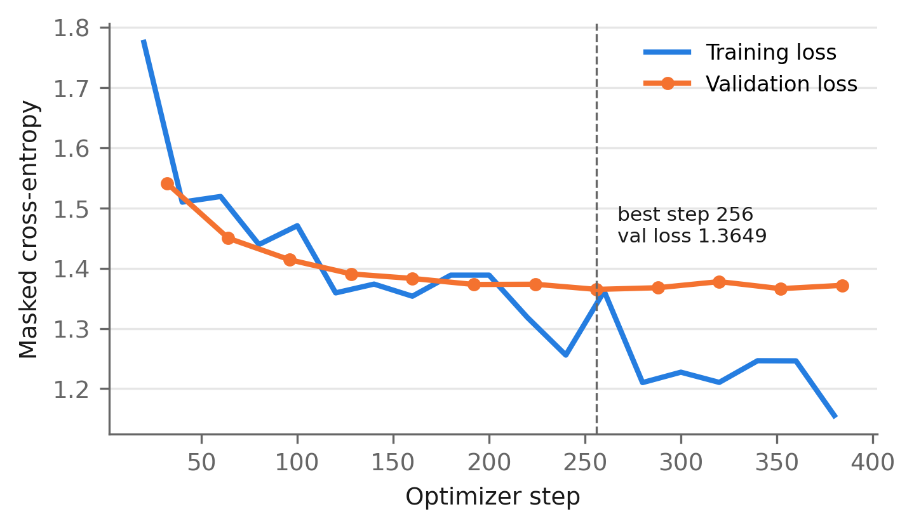

# EduGuard: Training Methodology, Metric Definitions and Results

This report describes how EduGuard's two models were trained, why each design choice was made and what it was chosen over, how every reported metric is computed, and what the results show. All numbers come from stored run artifacts (paths in §10).

- **Validation split:** used for all development decisions (§6).
- **Test split:** evaluated **once**, for the final model and the base model, after every decision was fixed (§7).
- **Published results:** §8 compares EduGuard with them, with the caveats that make such comparisons fair.

---

## 1. What was trained

| Model | Base | Method | Job in the app |
|---|---|---|---|
| **Bloom classifier** | Qwen2.5-0.5B-Instruct + 6-way classification head | LoRA, trained with **federated learning** (FedProx, 8 simulated sites) | Labels a question's Bloom level for teachers; also the fixed scorer in evaluation |
| **Multitask generator, v3.9** | Qwen2.5-1.5B-Instruct (causal LM) | LoRA supervised fine-tuning on three tasks jointly | Bloom-targeted question rewriting, closed-book QA, summarization |

The generator is deployed as a 4-bit GGUF file (Q4_K_M, 986 MB) and runs on CPU with llama.cpp. The classifier is deployed in fp32.

---

## 2. Data

### 2.1 Generator corpus (v3.9)

| Task | Train | Validation | Test | Source |
|---|---:|---:|---:|---|
| Bloom rewrite | 2,735 | 341 | 351 | 600 corrected course questions, each rewritten to other Bloom levels |
| Closed-book QA | 1,172 | 146 | 147 | Academic questions with short reference answers; no passage is given to the model |
| Summarization | 1,172 | 146 | 147 | OpenStax textbook sections, original academic examples, lecture-slide text |

**How the Bloom rewrite data was built**
- **Source questions:** 600 course questions went through an audited cleaning pass, which fixed missing-figure references, wrong action verbs and duplicates. Every edit is recorded in `final_corrected_dataset/Correction_Log*.csv`.
- **Training pairs:** each example asks the model to rewrite one question to one *other* Bloom level. *Direct* pairs go from the source to the target level. *Pivot* pairs link two rewrites of the same question.
- **Reference rewrites:** drafted with model assistance, then checked automatically for format, level and topic. They were **not** individually verified by human experts.
- **Split by source question:** splits are fixed per source question, so rewrites of a test question never appear in training.
- **Hidden input:** the source Bloom level is never given to the model, only the question and the target level.

**The v3.4 → v3.9 Remember correction.** Error analysis of v3.8 showed Remember was the only weak level: 26.2% classifier agreement. Many Remember reference targets were compound ("Define X *and* identify Y") or productive ("Write the formula for…"), which read as Understand.
- **What changed:** 249 training targets were rewritten as single-recall questions ("What is…", "State…", "Name…"). Each was kept only if the evaluation classifier labelled it Remember, and 8 duplicates were resolved by hand.
- **What stayed fixed:** the validation and test files are **byte-identical** to v3.8, so before/after comparisons are fair.

**Integrity checks.** Every data file is pinned by SHA-256 in `dataset_manifest.json`. Before training, a validator checks the loss mask on all 6,357 sequences (0 errors).

**Output lengths the model learned** (tokens, Qwen tokenizer):

| Task | Training targets: median / p95 / max | v3.9 generations: median / p95 / p99 |
|---|---|---|
| Bloom rewrite | 25 / 57 / 116 | 27 / 44 / 60 |
| QA | 40 / 62 / 121 | 45 / 73 / 107 |
| Summary | 130 / 360 / 638 | 106 / 258 / 431 |

### 2.2 Classifier corpus

The **Figshare Bloom dataset** is a public set of questions labelled with Bloom levels.
- **Splits:** 1,631 / 349 / 350 (train / validation / test).
- **Training class counts:** Understand 640, Remember 225, Evaluate 199, Apply 199, Analyze 192, Create 176.

---

## 3. Generator training (v3.9)

### 3.1 Model and adapter

- **Base model:** Qwen2.5-1.5B-Instruct (1.54B parameters), frozen.
- **LoRA:** rank 16, α = 32 (scaling 2.0), dropout 0.1, on all 7 projection matrices (q, k, v, o, gate, up, down).
- **Trainable parameters:** about 18.5M (1.2% of the model); the adapter is 74 MB.

### 3.2 Input format and loss

- **Prompt format:** each example is a Qwen chat conversation, with a task-specific system instruction, a user turn with the input, and the assistant turn with the target.
- **Loss masking:** loss is computed **only on assistant tokens**; prompt tokens get label −100. To save memory, logits are computed only at assistant positions, in 1,024-token chunks.
- **Context:** examples up to 8,192 tokens.

### 3.3 Task mixing and batching

- **Sampling:** weighted with replacement each epoch, at 50% rewrite, 25% QA and 25% summarization. That is about 2,540 rewrite, 1,270 QA and 1,270 summarization examples per epoch, seed 42.
- **Batching:** token-budget batching, up to 16 rows per batch, grouped by length in megabatches of 256.
- **Step count:** about 295 optimizer steps per epoch; 590 were scheduled for 2 epochs.

### 3.4 Optimisation

| Setting | Value |
|---|---|
| Optimizer | AdamW, learning rate 1×10⁻⁴, weight decay 0.01 |
| Schedule | Cosine decay, 3% warm-up |
| Precision | bf16 mixed precision, gradient checkpointing |
| Epochs | Maximum 2 |
| Validation | Every 32 steps, on the full validation split |
| Early stopping | Patience 4 evaluations on validation loss; best checkpoint restored |
| Seed | 42 |
| Hardware | 1 × NVIDIA RTX 4080 (16 GB); training time 3,345 s (56 min) |

### 3.5 Training outcome

Validation loss (masked cross-entropy on assistant tokens) at each evaluation:

| Step | 32 | 64 | 96 | 128 | 160 | 192 | 224 | **256** | 288 | 320 | 352 | 384 |
|---|---|---|---|---|---|---|---|---|---|---|---|---|
| Val. loss | 1.541 | 1.450 | 1.414 | 1.391 | 1.383 | 1.373 | 1.373 | **1.365** | 1.368 | 1.378 | 1.366 | 1.372 |

- **Best checkpoint:** step **256** (epoch 0.87), validation loss **1.3649**.
- **Stopping:** at step 384 (epoch 1.30), after 4 evaluations without improvement. Training loss kept falling while validation loss levelled off, so stopping prevented over-fitting.
- **Comparison with v3.8:** v3.9's best validation loss is 0.005 above v3.8's (1.3597) on the same validation files. That's expected: the corrected Remember targets no longer match the unchanged validation references word for word. Loss measures reproducing the reference text, not hitting the requested level, so task metrics (§5–6) are what count.



### 3.6 Why this design, and what it was chosen over

Every choice follows from one of two things: the deployment constraint (offline, CPU inference, one consumer GPU for training), or a failure we measured.

| Decision | Chosen | Alternatives | Why not the alternatives |
|---|---|---|---|
| Teach the task | Supervised fine-tuning | Better prompting of the base model | Measured: with the same instructions the base model copies 32–37% of questions and produces Remember rewrites only 1.6% (validation) / 3.1% (test) of the time. It does not separate the levels, and prompt wording cannot add that. |
| Update method | LoRA r16, all 7 projections | Full fine-tuning | Full fine-tuning of 1.54B weights with 8k-token examples is tight on 16 GB. It also forgets more of the base model's other abilities (Biderman et al., 2024), and this one model must still answer and summarize. LoRA trains 1.2% of the weights, and the 74 MB adapter is cheap to retrain per institution. |
| | | QLoRA (4-bit base during training) | The model fits in bf16, so 4-bit training only adds quantization noise. Quantization happens once, after training, for deployment. |
| | | Adapters on attention only | Dettmers et al. (2023) found LoRA on all linear layers is needed to match full fine-tuning; adapting all 7 projections costs few extra parameters. |
| Number of models | One multitask adapter | Three separate task adapters or models | A CPU deployment can hold one generator in RAM; switching adapters per request adds latency. Joint training also keeps the rewrite task from overwriting answering and summarizing. |
| Task mix | 50% rewrite / 25% QA / 25% summary, resampled each epoch | Proportional to data size; one task at a time | Rewriting is the primary moderation task and gets half of every epoch. Training tasks one after another causes forgetting of the earlier ones. |
| Loss | Assistant tokens only | Loss on the whole sequence | Learning to reproduce prompts and inputs wastes capacity and rewards echoing the input, which is the base model's main failure. |
| Model size | 1.5B | 0.5B; 3B; 7B | 1.5B is the largest size within the interactive CPU budget (4–9 s per rewrite at 4-bit). 0.5B is the classifier's size and too weak for generation. 3B and 7B configurations are released but not yet evaluated. |
| Model family | Qwen2.5 | Llama 3.2, Gemma 2, Phi | Not compared head-to-head. Qwen2.5 was chosen so classifier and generator share one tokenizer and chat template, and for its instruction-following at small sizes. |
| Fixing the weakest level | Correct 249 Remember targets | More data; larger model | The v3.8 error analysis traced Remember's 26% to inconsistent targets, not capacity. With everything else fixed, the correction alone gave +56 points. |
| Alignment | SFT only | DPO / RLHF | No preference pairs exist. The rewrite target is verifiable at inference by the classifier. |
| When to stop | Early stopping on validation loss, best checkpoint restored | Fixed number of epochs | After step 256, validation loss stopped improving while training loss kept falling, which is the onset of over-fitting. |
| Decoding | Greedy, per-task caps, loop guard | Sampling | Greedy decoding makes every evaluation reproducible. The loop guard stops the repetition loops small models fall into on long summaries. |

---

## 4. Federated Bloom classifier training

| Setting | Value |
|---|---|
| Model | Qwen2.5-0.5B-Instruct + 6-way classification head; LoRA r = 32, α = 64, dropout 0.1; classification head trained |
| Loss | Cross-entropy with class weights (capped at 3.0) and label smoothing 0.05; inputs up to 256 tokens |
| Clients | 8 simulated "teacher sites" holding separate portions of the training set; IID (stratified) and Dirichlet non-IID (α ∈ {0.1, 0.5, 1.0}) splits |
| One round | Each client starts from the global adapter, trains 3 local epochs (lr 1×10⁻⁴, effective batch 16), and sends back **only** the LoRA and head weights |
| Aggregation | FedAvg (sample-weighted average), or FedProx with a proximal term μ = 0.01 added to each client's loss |
| Rounds | 5 and 20 |
| Model selection | Best validation accuracy; reported once on the 350-item test set |
| Deployed model | FedProx, IID, 20 rounds, best round 20 (merged for deployment) |

Questions never leave a client. Federated learning on its own isn't a formal privacy guarantee; a variant with differential privacy (DP-SGD) collapsed to near-chance accuracy and is not used.

**Why federated learning here, and why these choices.**

| Decision | Chosen | Why |
|---|---|---|
| What is federated | The classifier only | Teachers' private data is exam questions and their Bloom labels, which is exactly what the classifier learns from. The generator is trained only on public or synthetic text, so federating it would add about 74 MB of traffic per site per round and a GPU at every site, with no privacy gain. |
| Aggregation | FedProx (μ = 0.01) | It matches FedAvg on IID splits (0.806 vs 0.800), and its proximal term keeps a site with unusual data from pulling the shared model too far. Real schools will not hold identically distributed questions. |
| What is shared | LoRA + head weights only | About 1% of the model per round; no question text. |
| Rounds | 20 | 20 rounds clearly beat 5 (FedAvg 0.666 → 0.800). |
| Differential privacy | Not deployed | DP-SGD reduced accuracy to 0.129 (near chance). We state plainly that we make no DP claim. |
| Learning in deployment | Periodic rounds over **teacher-confirmed** labels, not per request | Unconfirmed predictions would teach the model its own mistakes, and per-request updates invite poisoning. A new global model is promoted only if held-out accuracy does not drop by more than 1 point. |

---

## 5. How the metrics are computed

### 5.1 Decoding used for every evaluation

- **Decoding:** greedy (no sampling).
- **Per-task output limits:** 160 tokens (rewrite), 192 (QA), 1,104 (summarization; longest training summary + 25%).
- **Loop guard:** generation stops at a degenerate loop. A *span* loop is the last 24 generated tokens repeating an earlier span verbatim; the output is then cut back to the last complete sentence. A *template* loop is 4 consecutive sentences starting with the same 6 words; the first is kept. On 1,464 reference texts the guard never triggered falsely.
- **Prompts:** the same prompts and data are used for the base model, the LoRA model and the GGUF export.

### 5.2 Bloom rewriting

The **evaluation classifier** is a fixed, centrally trained 0.5B Bloom classifier (`models/qwen_bloom_merged0.5B`), never updated during the study. It is deliberately a different model from the deployed federated one.

| Metric | How it is computed |
|---|---|
| **Target accuracy** | Share of rewrites where the classifier's predicted level equals the requested level |
| **Macro-F1** | F1 per requested level (classifier prediction vs. requested level), averaged over the 6 levels |
| **Per-level accuracy** | Target accuracy within each requested level |
| **Format valid** | Non-empty; reads as a question or an exam instruction (contains "?" or starts with a question or instruction word); no meta-commentary ("Here is the rewritten question…"); not an answer or a declarative statement |
| **Topic preserved (bge-m3)** | Cosine similarity of bge-m3 embeddings between source and rewrite ≥ threshold. The **threshold is calibrated**: the 5th percentile of the same similarity over all *training* reference pairs (0.578). So a rewrite counts as "on topic" if it is at least as close to its source as 95% of human references are to theirs |
| **Near-copy of source** | ROUGE-L between source and rewrite > the 95th percentile of the same score over training reference pairs (0.581). Catches rewrites that barely change the question |
| **Trivial verb swap** | Same content words as the source once common Bloom verbs ("explain", "analyze"…) are removed |
| **Fully validated** | All of: target match with classifier confidence ≥ 0.5, topic preserved, not a trivial swap, and format valid (a scenario-first Evaluate item marked declarative also counts) |
| **Agreement with the reference rewrite** | ROUGE-L and BERTScore F1 between the model's rewrite and the reference rewrite for the same source and target. Copying the source cannot raise these |
| **Reference ceiling** | The same classifier and checks applied to the *reference* rewrites, showing what the instrument gives "correct" answers. A low ceiling (e.g. Remember 0.44) means the classifier itself is unsure on that level |

### 5.3 Closed-book QA

| Metric | How it is computed |
|---|---|
| **BERTScore F1** | roberta-large, layer 17, F1 rescaled with the official English baseline, so 0 ≈ unrelated text and 1 = identical meaning; can be negative |
| **bge-m3 similarity** | Cosine similarity of bge-m3 embeddings of answer and reference |
| **ROUGE-L (length-matched)** | Markdown removed, then the answer cut to the reference's length, then ROUGE-L. A long answer can't score well just by containing more words |
| **ROUGE-1/2/L (raw)** | `rouge_score` with Porter stemming, F-measure, averaged over items |
| **Length** | Median words, model vs. reference |

### 5.4 Summarization

| Metric | How it is computed |
|---|---|
| **ROUGE-1/2/L** | `rouge_score`, Porter stemming, F-measure |
| **ROUGE-Lsum** | Summary-level ROUGE-L (sentence-split), the standard summarization variant |
| **BERTScore F1** | As for QA; inputs longer than 512 tokens are truncated by the scorer |
| **bge-m3 similarity** | Cosine similarity with the reference summary |
| **By source type / length** | The same ROUGE scores grouped by source type and length category |

### 5.5 Independent LLM judge

Lexical and embedding metrics can't tell whether an answer is *true*, so a separate local judge rates outputs.
- **Judge model:** Qwen2.5-7B-Instruct, 4-bit NF4, greedy decoding, JSON output.

| Task | Judge prompt | Scores |
|---|---|---|
| QA | Question, reference answer and student answer, in tags. Step 1: does the answer address the question? Step 2: verdict | **Accuracy** = share "correct"; **lenient accuracy** = "correct" or "partially correct". Off-question answers count as incorrect |
| Summarization | Source, reference and summary | **Faithful** = no unsupported claims; **acceptable** = faithful and coverage ≥ 3/5 |
| Bloom rewrite | Source and rewrite only; the judge **never sees the requested level** | **Level accuracy** = judge's level equals requested level; topic kept |

**Reliability check.** Before any judge score is reported, the judge is tested on reference outputs:
- it must call the matching reference answer or summary correct / faithful **≥ 90%** of the time;
- it must call a reference from a *different* item incorrect / unfaithful **≥ 90%** of the time.

A task that fails is marked "not reliable" and isn't reported. Confidence intervals are 95% bootstrap intervals (2,000 resamples, seed 42).

### 5.6 Classifier metrics

| Metric | Definition |
|---|---|
| Accuracy | Exact level match |
| Macro-F1 | Mean F1 over the 6 levels |
| QWK | Quadratic-weighted Cohen's κ: levels are ordered, so predicting Analyze for Apply is penalised less than predicting Create |
| Within-1 | Prediction at most one level away |
| Severe error | Prediction three or more levels away |
| ECE | Expected calibration error: gap between predicted confidence and actual accuracy, averaged over confidence bins |

### 5.7 Formulas, and why these metrics

**Formulas.** For N items, requested level tᵢ and classifier prediction ŷᵢ with confidence cᵢ:

- **Target accuracy** = (1/N) · Σᵢ 1[ŷᵢ = tᵢ]
- **Macro-F1** = (1/6) · Σ_levels F1(level), where for each level, precision = correct predictions of that level ÷ all predictions of it, recall = correct ÷ all requests for it, and F1 = 2PR/(P+R)
- **Fully validated** = (1/N) · Σᵢ 1[ŷᵢ = tᵢ ∧ cᵢ ≥ 0.5 ∧ topicᵢ ∧ ¬near_copyᵢ ∧ ¬trivialᵢ ∧ formatᵢ]
- **Topic preserved**ᵢ = 1[cos(e(sourceᵢ), e(rewriteᵢ)) ≥ τ], where e is the bge-m3 embedding and τ = 0.578. τ is the 5th percentile of the same cosine over all training reference pairs.
- **ROUGE-L** = F-measure of the longest common subsequence (LCS) of stemmed words: P = LCS/|output|, R = LCS/|reference|, F = 2PR/(P+R)
- **BERTScore F1**: each token of one text is matched to its most similar token (cosine of contextual embeddings) in the other text, giving precision and recall, and F1 combines them. Rescaled as (F1 − b)/(1 − b), where b is the published English baseline, so 0 ≈ unrelated text and 1 = identical.
- **Bootstrap 95% CI**: resample the N items with replacement 2,000 times, recompute the mean each time, and take the 2.5th and 97.5th percentiles.

**Why these metrics, and not others.**

| Metric family | What it answers | Why it is needed | Not used, and why |
|---|---|---|---|
| Classifier target accuracy, macro-F1 | Did the rewrite reach the requested level? | The task's defining property, checked by a model never trained on our rewrites | — |
| Blind LLM judge | Same question, from a different kind of judge | A second, independent opinion that never sees the requested level, so it cannot be "led" | Using the judge alone: LLM judges can disagree with experts, so we calibrate it first |
| Topic cosine, near-copy, trivial swap, format | Is it the same question, really rewritten, and usable? | A copy keeps the topic perfectly but is useless; a perfect-level rewrite on another topic is also useless | — |
| Fully validated | Does one rewrite pass *everything* at once? | Teachers need rewrites that are right on every count, not on average | — |
| ROUGE-L, BERTScore to reference | How close to an expert-style answer? | The standard reference-based measures, so results are comparable | **Exact match, BLEU:** many different rewrites or answers are correct, so string identity under-rates good outputs |
| Length-matched ROUGE-L (QA) | Same, without rewarding long answers | Plain ROUGE recall rises with length | — |
| Judge correctness (QA) | Is the answer *true*? | Similarity metrics cannot detect a fluent wrong answer | — |
| Reference ceiling | What does the instrument give known-good outputs? | Without it, 76% from a judge that itself gives references 76% looks low; with it, 76% is at the ceiling | — |

**How to read the numbers.**

- Rescaled BERTScore is not a percentage: 0.34 means clearly related meaning, and 0 means no more related than random text.
- ROUGE values around 0.25–0.40 are normal for abstractive outputs, because different wording for the same content scores low. Compare base and fine-tuned models on the *same* items, never ROUGE across different datasets.
- Any accuracy should be read against its reference ceiling.

### 5.8 Human evaluation (prepared, ratings pending)

The blinded annotation package is in `paper/elsevier/human_annotation/`.
- **Bloom rewrites:** 48 source questions × 3 versions (v3.9, base model, reference).
- **QA:** 62 items × 2 systems. **Summarization:** 41 items × 2 systems.
- **Design:** two independent raters; rows shuffled with seed 42; system names hidden. For rewrites, raters record the perceived level *before* seeing the requested one.
- **Analysis:** `analyze_human_annotation.py` reports per-system means with 95% CIs, and inter-rater agreement as Cohen's κ (yes/no) and quadratic-weighted κ (ordinal).

---

## 6. Results (validation split)

### 6.1 Bloom rewriting

| Measure | Base model | **v3.9** | Reference rewrites |
|---|---:|---:|---:|
| Target accuracy (classifier) | 0.616 | **0.927** | 0.798 |
| Macro-F1 | 0.568 | **0.927** | — |
| Fully validated | 0.601 | **0.804** | — |
| Format valid | 0.994 | **0.997** | 0.956 |
| Topic preserved (bge-m3) | 0.994 | 0.877 | 0.962 |
| Near-copy of source (lower is better) | 0.320 | **0.032** | 0.053 |
| ROUGE-L to reference rewrite | 0.295 | 0.306 | — |
| BERTScore F1 to reference rewrite | 0.381 | 0.377 | — |
| **Judge: blind level = requested** (95% CI) | 0.601 [0.548, 0.654] | **0.780** [0.736, 0.824] | 0.768 (judge ceiling) |
| Judge: topic kept | 0.997 | 0.997 | — |

| Requested level | N | Base | v3.8 | **v3.9** | Reference (classifier ceiling) |
|---|---:|---:|---:|---:|---:|
| Remember | 61 | 0.016 | 0.262 | **0.820** | 0.443 |
| Understand | 59 | 0.712 | 0.949 | **0.983** | 0.848 |
| Apply | 52 | 0.769 | 0.904 | 0.885 | 0.923 |
| Analyze | 52 | 0.404 | 0.942 | **0.981** | 0.769 |
| Evaluate | 57 | 0.825 | 0.983 | **1.000** | 0.983 |
| Create | 60 | 0.983 | 0.983 | 0.900 | 0.850 |
| **All** | 341 | 0.616 | 0.830 | **0.927** | 0.798 |

What the numbers mean:
- **The base model mostly copies.** 32% of its rewrites are near-copies of the question, and it almost never produces Remember (1.6%).
- **v3.9 reaches the requested level** in 92.7% of cases by the classifier and 78.0% by the independent judge. The judge's own agreement with the reference rewrites is 76.8%, so v3.9 is at the judge's ceiling.
- **The data correction drove most of the Remember gain.** With the model and optimiser unchanged, rewriting 249 Remember targets lifted Remember from 26.2% to 82.0% (v3.8 → v3.9).
- **v3.9 scores above the references on the classifier.** That partly reflects phrasing aligned to the classifier, because the same classifier filtered the corrected Remember targets. That's why the independent judge and human ratings are reported alongside it.
- **Topic preservation is lower than the base model's** (0.877 vs 0.994). That's the cost of not copying: a near-copy trivially keeps the topic.
- **Pair types:** direct pairs reach 92.2% (N = 295), pivot pairs 95.7% (N = 46).

### 6.2 Closed-book QA

| Measure | Base model | **v3.9** |
|---|---:|---:|
| BERTScore F1 | 0.128 | **0.343** |
| bge-m3 similarity | 0.803 | **0.820** |
| ROUGE-L, length-matched | 0.216 | **0.274** |
| ROUGE-1 / 2 / L (raw) | 0.244 / 0.070 / 0.160 | **0.378 / 0.111 / 0.266** |
| Median length, words (reference 31.5) | 146.0 | **35.5** |
| **Judge: correct** (95% CI) | **0.952** [0.918, 0.986] | 0.644 [0.569, 0.719] |
| Judge: correct or partially correct | **0.993** | 0.973 |

**Concision costs correctness.**
- **Similarity metrics improve:** fine-tuning brings answers to reference length and nearly triples BERTScore.
- **But the calibrated judge rates fewer answers fully correct:** 64.4% vs 95.2% for the base model. The judge passed its QA reliability check (100% / 100%), so this verdict is trustworthy.
- **Cause:** training on short reference answers taught the model to stop early, often before the decisive detail. Almost all v3.9 answers are still at least partially correct (97.3%).
- **Recommended fix:** longer QA training targets, or answering from uploaded course material. The app already does the latter when notes are uploaded.

### 6.3 Summarization

| Measure | Base model | **v3.9** |
|---|---:|---:|
| ROUGE-1 / 2 | 0.312 / 0.079 | **0.395 / 0.120** |
| ROUGE-Lsum | 0.287 | **0.357** |
| BERTScore F1 | −0.001 | **0.268** |
| bge-m3 similarity | 0.798 | **0.835** |
| Median length, words (reference 89.0) | 303.5 | **77.5** |
| Stopped by loop guard / hit length limit | — | 6 / 146, 1 / 146 |

| v3.9 by source type | N | ROUGE-1 | ROUGE-2 | ROUGE-L |
|---|---:|---:|---:|---:|
| OpenStax textbook section | 116 | 0.369 | 0.109 | 0.223 |
| Original academic example | 29 | 0.496 | 0.166 | 0.336 |
| Lecture-slide text | 1 | 0.458 | 0.108 | 0.249 |

- **Base model:** writes summaries 3.4× the reference length, with BERTScore at baseline level (no meaningful similarity).
- **v3.9:** summarizes at reference length and improves every metric. Long textbook sections remain the hardest case.
- **Faithfulness can't be reported from the judge,** which failed its summarization reliability check: it called 72.5% of *mismatched* summaries faithful. Faithfulness will come from the human ratings.

### 6.4 Federated classifier (Figshare test, N = 350)

| Model | Accuracy | Macro-F1 | QWK | Within-1 | Severe | ECE |
|---|---:|---:|---:|---:|---:|---:|
| TF-IDF + SVM | 0.751 | 0.725 | 0.747 | 0.883 | 0.066 | — |
| Centralized 0.5B LoRA | 0.831 | 0.825 | 0.879 | 0.920 | 0.037 | 0.054 |
| FedAvg, IID, 20 rounds | 0.800 | 0.792 | 0.841 | 0.894 | 0.049 | 0.040 |
| **FedProx, IID, 20 rounds (deployed)** | **0.806** | **0.798** | **0.849** | **0.909** | **0.043** | **0.054** |
| FedAvg, non-IID α = 0.5, 5 rounds | 0.503 | 0.495 | — | — | — | — |
| FedProx, non-IID α = 0.5, 5 rounds | 0.457 | — | — | — | — | — |
| FedProx + DP-SGD | 0.129 | — | — | — | — | — |

- **Federated vs. centralized:** federated training comes within **2.6 points** of centralized accuracy without pooling any questions.
- **Rounds matter:** 20 rounds clearly beat 5.
- **Open problem:** strong label skew between sites (non-IID) remains unsolved.
- **Deployment check:** in the deployed CPU setting, the fp32 classifier gives 0.848 accuracy on the 349 validation questions, at 744 ms per question.

### 6.5 Deployment (CPU)

| | Value |
|---|---|
| Generator file | v3.9 Q4_K_M GGUF, 986 MB; tokenizer and chat template verified identical to the HF model |
| Interactive latency (i7-13700K, through the app) | Rewrite 4–9 s, QA 3–6 s, summary ≈ 7–14 s |
| Full-precision reference (bf16, RTX 4080) | 4.4 s per rewrite, 7.2 s per QA answer, 18.4 s per summary |
| Packaged app | 4.0 GB (CPU-only PyTorch; GPU used for generation automatically when the llama.cpp build supports it) |
| Q4_K_M vs bf16 quality on validation | See the table below (`results/…_gguf_q4_k_m/`, full 633 items, CPU only) |

**4-bit (Q4_K_M, CPU) against full precision (bf16, GPU), validation split:**

| Measure | bf16 | Q4_K_M | Difference |
|---|---:|---:|---|
| Rewrite target accuracy (classifier) | 0.927 | 0.903 | −0.023, paired McNemar p = 0.27: not significant |
| Judge: blind level = requested | 0.780 | 0.821 | +0.041, McNemar p = 0.11: not significant |
| Fully validated | 0.804 | 0.856 | +0.053 |
| Near-copy of source | 0.032 | 0.091 | +0.059 (base model 0.320) |
| Topic preserved | 0.877 | 0.953 | +0.076 |
| QA BERTScore F1 | 0.343 | 0.369 | +0.026 |
| QA judged correct | 0.644 | 0.671 | +0.027, McNemar p = 0.65: not significant |
| Summary ROUGE-Lsum / BERTScore | 0.357 / 0.268 | 0.376 / 0.260 | +0.019 / −0.007 |
| Summaries stopped by loop guard | 6 / 146 | **27 / 146** | +21 |
| Median summary length (reference 89 words) | 77.5 | 98.5 | +21 |
| CPU latency, median (p90) | — | rewrite 5.4 s (7.3), QA 3.5 s (4.9), summary 22.7 s (48.2) at the 1,104-token evaluation cap | |

What this shows:

- **Quantization keeps task quality.** No level-accuracy or QA-correctness difference is significant.
- **It nudges behaviour back toward the base model:** a few more near-copies (9.1% vs 3.2%, against the base model's 32%) and higher topic preservation. That is why the fully validated rate goes *up*.
- **The one clear cost is summary repetition loops:** 18.5% vs 4.1%. The loop guard trims them, so scores hold, but those summaries end early.
- **The 4-bit model also copies its source more.** Verbatim 8-word spans make up 38% of its summaries against 12% for bf16 (41 summaries where both are available; references copy 3%). That copying, not better summarizing, is why its ROUGE is higher than bf16's.

**Fix adopted: repetition penalty 1.1 for summaries only** (`results/…_gguf_q4_k_m_summ_rp110/`, same 146 summaries, CPU):

| Summaries | 4-bit, no penalty | **4-bit, penalty 1.1** | bf16 |
|---|---:|---:|---:|
| Stopped by loop guard | 27 | **7** | 6 |
| Verbatim copied from source (mean, 41 shared items) | 0.381 | **0.245** | 0.118 |
| ROUGE-1 / 2 / L | 0.414 / 0.136 / 0.263 | 0.412 / 0.124 / 0.245 | 0.395 / 0.120 / 0.245 |
| ROUGE-Lsum | 0.376 | 0.371 | 0.357 |
| BERTScore F1 | 0.260 | 0.253 | 0.268 |
| Median length, words (reference 89) | 98.5 | 105 | 77.5 |

- **Effect:** the penalty brings loops back to the bf16 level and cuts copying by a third, with ROUGE-L equal to bf16.
- **Cost:** BERTScore is slightly lower (0.253 vs 0.260). On short pasted texts it can make a bullet terse, a list of terms instead of a sentence.
- **Scope:** the app now uses it for summaries (`generator_summary_repeat_penalty = 1.1`). Rewrites and QA keep 1.0.
- **Further options:** importance-matrix quantization, or a Q5_K_M/Q6_K export.

---

## 7. Results on the held-out test split (evaluated once)

The test split was run once, after all choices were fixed, with the final v3.9 model and the base model. Same prompts, decoding, classifier and judge as validation.

**Judge reliability on test.**
- *QA:* accepted 100% of matched references and rejected 97.3% of mismatched ones, so its verdicts are **reliable**.
- *Summarization:* rejected only 25% of mismatched summaries, so it is **not reliable**, as on validation. Summary faithfulness and coverage verdicts are therefore not reported.
- *Bloom:* agrees with the reference rewrites 75.5% of the time; this is the judge's ceiling.

### 7.1 Bloom rewriting (N = 351)

| Measure | Base | **v3.9** | v3.9 on validation | Reference |
|---|---:|---:|---:|---:|
| Classifier agrees with target level | 0.644 | **0.926** | 0.927 | 0.803 |
| Macro-F1 | 0.601 | **0.926** | 0.927 | — |
| Fully validated | 0.618 | **0.803** | 0.804 | — |
| Format valid | 0.994 | **1.000** | 0.997 | 0.946 |
| Topic preserved (bge-m3) | 0.994 | 0.883 | 0.877 | 0.949 |
| Near-copy of source (lower is better) | 0.368 | **0.037** | 0.032 | 0.066 |
| ROUGE-L / BERTScore to reference rewrite | 0.302 / 0.381 | 0.318 / 0.387 | 0.306 / 0.377 | — |
| **Judge: blind level = requested** (95% CI) | 0.613 [0.561, 0.661] | **0.761** [0.715, 0.806] | 0.780 | 0.755 (ceiling) |
| Judge and classifier both agree | 0.524 | **0.724** | 0.745 | — |
| Judge: topic kept | 0.992 | 0.997 | 0.997 | — |

| Requested level | N | Classifier: base | **Classifier: v3.9** | Classifier: reference | Judge: base | **Judge: v3.9** | Judge: reference |
|---|---:|---:|---:|---:|---:|---:|---:|
| Remember | 64 | 0.031 | **0.859** | 0.453 | 0.141 | **0.719** | 0.641 |
| Understand | 61 | 0.721 | **0.934** | 0.951 | 0.885 | **0.902** | 0.902 |
| Apply | 49 | 0.694 | **0.959** | 0.857 | 0.612 | **0.878** | 0.980 |
| Analyze | 53 | 0.547 | **0.943** | 0.868 | 0.264 | **0.849** | 0.774 |
| Evaluate | 62 | 0.903 | **1.000** | 0.903 | **0.952** | 0.645 | 0.758 |
| Create | 62 | **0.984** | 0.871 | 0.823 | **0.790** | 0.613 | 0.532 |

### 7.2 Closed-book QA (N = 147)

| Measure | Base | **v3.9** | v3.9 on validation |
|---|---:|---:|---:|
| BERTScore F1 | 0.126 | **0.341** | 0.343 |
| bge-m3 similarity | 0.799 | **0.820** | 0.820 |
| ROUGE-L, length-matched | 0.207 | **0.271** | 0.274 |
| ROUGE-1 / 2 / L (raw) | 0.247 / 0.067 / 0.161 | **0.387 / 0.116 / 0.268** | 0.378 / 0.111 / 0.266 |
| Median length, words (reference 31) | 148 | **36** | 35.5 |
| **Judge: correct** (95% CI) | **0.973** [0.946, 0.993] | 0.728 [0.653, 0.796] | 0.644 |
| Judge: correct or partially correct | **0.980** [0.952, 1.000] | 0.966 [0.932, 0.993] | 0.973 |

### 7.3 Summarization (N = 147)

| Measure | Base | **v3.9** | v3.9 on validation |
|---|---:|---:|---:|
| ROUGE-1 / 2 / L | 0.306 / 0.079 / 0.170 | **0.399 / 0.121 / 0.248** | 0.395 / 0.120 / 0.245 |
| ROUGE-Lsum | 0.282 | **0.361** | 0.357 |
| BERTScore F1 | −0.009 | **0.265** | 0.268 |
| bge-m3 similarity | 0.788 | **0.823** | 0.835 |
| Median length, words (reference 86) | 281 | **79** | 77.5 |
| Stopped by loop guard | 2 / 147 | 4 / 147 | 6 / 146 |

### 7.4 What the test results show

- **No overfitting to validation.** Every rewrite and similarity metric is within 2 points of its validation value. Target accuracy is 92.6% vs 92.7%, and fully validated 80.3% vs 80.4%. The checkpoint and design choices made on validation generalize to unseen questions.
- **Rewriting is the clear win.** +28.2 points by the classifier, +14.8 by the blind judge, and +18.5 fully validated. The biggest gains are where the base model fails worst:

  | Level | Classifier: base → v3.9 | Judge: base → v3.9 |
  |---|---|---|
  | Remember | 3.1% → 85.9% | 14.1% → 71.9% |
  | Analyze | 54.7% → 94.3% | 26.4% → 84.9% |

- **Evaluate and Create are unresolved.** The judge prefers the base model here (0.952 and 0.790 vs 0.645 and 0.613), while the classifier prefers v3.9. The judge itself agrees with the *reference* Create rewrites only 53.2% of the time. The base model's long, open-ended phrasing also tends to read as higher-order to a generalist judge, whatever was requested. Human ratings will settle this.
- **QA keeps the validation trade-off.** Answers are concise and much closer to the references (BERTScore ×2.7), but fewer are judged fully correct (72.8% vs 97.3%); 96.6% are at least partially correct. Two causes:
  - Short training answers teach the model to stop early.
  - Fine-tuning on facts the model didn't already know raises hallucination (Gekhman et al., 2024), and fine-tuned 1–7B models lose some earlier ability (Luo et al., 2023).

  LoRA limits this forgetting but does not remove it (Biderman et al., 2024). In the app, questions about uploaded notes are answered from the notes, which sidesteps closed-book knowledge.
- **Summaries are better on every reference metric.** They are also at reference length, where the base model's are 3.3× longer.

---

## 8. Comparison with published results

No published system does exactly what EduGuard does: rewrite an *existing* exam question to a requested Bloom level, locally. The closest published numbers are below. They are **context, not a leaderboard**: tasks, subjects, datasets and judges differ.

### 8.1 Hitting a requested Bloom level

| System | Size / where it runs | Task | Requested level achieved | Judged by |
|---|---|---|---:|---|
| **EduGuard v3.9** | **1.5B, 4-bit, local CPU** | Rewrite an existing question, keep its topic | **76.1%** (blind judge), **92.6%** (classifier) | 7B judge / independent classifier; 351 test items |
| Qwen2.5-1.5B base, same prompt | 1.5B, local | Same | 61.3% / 64.4% | Same |
| GPT-4 | Cloud | Generate a new question from a topic | 70.0% | 2 human experts (Scaria et al., 2024, Table 4) |
| GPT-3.5 | Cloud | Same | 73.4% | Same |
| Llama-2-70B | 70B | Same | 61.7% | Same |
| Mistral-7B | 7B | Same | 60.0% | Same |
| PaLM 2 | Cloud | Same | 60.0% | Same |
| GPT-4 Turbo | Cloud | Generate from a textbook passage | 65–69% (Remember, Understand, Create) | Teachers (Maity et al., 2024) |

**Reading it fairly.**
- In Scaria et al., the percentages count only questions that the experts first rated "high quality" (78% of all questions). Their judges are human experts; ours are a 7B model and a classifier.
- Their task (write a new question about a topic) is easier in one way (no topic to preserve) and harder in another (no starting question).
- **What can be claimed:** a 1.5B model on a desktop CPU reaches requested-level adherence in the same range as prompted frontier models (60–73%), and well above its own prompted base model.
- **What cannot be claimed yet:** that it beats GPT-4. That needs human ratings on the same items, which are prepared (`human_annotation/`).

### 8.2 Bloom classification

| Classifier | Training | Test data | Score |
|---|---|---|---|
| **EduGuard (FedProx, 0.5B)** | **Federated across 8 sites; no data pooled** | Held-out Figshare test, 350 questions, mixed subjects | **0.806 accuracy, 0.798 macro-F1, QWK 0.849** |
| EduGuard (centralized, 0.5B) | Pooled | Same | 0.831 / 0.825 |
| BloomNet (Waheed et al., 2021) | Centralized, RoBERTa-based | Own 600-question set (5-fold CV) → different 141-question set | 0.875 → **0.704** accuracy |
| RoBERTa (same paper) | Centralized | Same | 0.820 → 0.687 |
| TF-POS-IDF + word2vec + SVM (Mohammed & Omar, 2020) | Centralized | 600-question set / 141-question set | 0.897 / 0.837 weighted F1 |

**Reading it fairly.**
- Published in-dataset scores come from small single-source sets of 100 questions per level.
- BloomNet's own numbers show a 17-point drop when the dataset changes.
- EduGuard's 0.806 is on a held-out, mixed-subject test set never used for tuning. It is obtained *without pooling any site's questions*, and federation costs only 2.6 points against the same model trained centrally.

### 8.3 Why a small local model is a reasonable bet

- Small task-specific models can beat much larger prompted ones on narrow tasks. A fine-tuned 770M T5 outperformed few-shot 540B PaLM on a benchmark (Hsieh et al., 2023).
- EduGuard shows the same pattern for Bloom-level rewriting. Fine-tuning the 1.5B model adds +28 points (classifier) and +15 points (judge), bringing it into the range of models 45× larger or cloud-only.
- **Its costs are reported, not hidden:** lower closed-book QA correctness, and an unresolved Evaluate/Create disagreement between judges.

### 8.4 References for this report

- Biderman, D., Portes, J., Gonzalez Ortiz, J.J., et al. (2024). LoRA Learns Less and Forgets Less. *TMLR*. arXiv:2405.09673.
- Dettmers, T., Pagnoni, A., Holtzman, A., Zettlemoyer, L. (2023). QLoRA: Efficient Finetuning of Quantized LLMs. *NeurIPS*.
- Gekhman, Z., Yona, G., Aharoni, R., et al. (2024). Does Fine-Tuning LLMs on New Knowledge Encourage Hallucinations? *EMNLP*. arXiv:2405.05904.
- Hsieh, C.-Y., Li, C.-L., Yeh, C.-K., et al. (2023). Distilling Step-by-Step! Outperforming Larger Language Models with Less Training Data and Smaller Model Sizes. *Findings of ACL*. arXiv:2305.02301.
- Luo, Y., Yang, Z., Meng, F., et al. (2023). An Empirical Study of Catastrophic Forgetting in Large Language Models During Continual Fine-tuning. arXiv:2308.08747.
- Maity, S., Deroy, A., Sarkar, S. (2024). How Effective is GPT-4 Turbo in Generating School-Level Questions from Textbooks Based on Bloom's Revised Taxonomy? arXiv:2406.15211.
- Mohammed, M., Omar, N. (2020). Question classification based on Bloom's taxonomy cognitive domain using modified TF-IDF and word2vec. *PLOS ONE* 15(3): e0230442.
- Scaria, N., Chenna, S.D., Subramani, D. (2024). Automated Educational Question Generation at Different Bloom's Skill Levels Using Large Language Models: Strategies and Evaluation. *AIED 2024*, LNAI 14830. doi:10.1007/978-3-031-64299-9_12.
- Waheed, A., Goyal, M., Mittal, N., et al. (2021). BloomNet: A Robust Transformer based model for Bloom's Learning Outcome Classification. *ICNLSP 2021*, pp. 209–218. arXiv:2108.07249.

---

## 9. Limitations

- **Synthetic references:** reference rewrites were drafted with model assistance and checked automatically, not by experts.
- **Classifier alignment:** the evaluation classifier also filtered the 249 corrected Remember targets. The blind judge and human ratings are the mitigations.
- **QA:** correctness drops after fine-tuning (§6.2, §7.2).
- **Summarization:** the judge failed calibration on both splits, so faithfulness relies on pending human ratings.
- **Evaluate / Create:** judge and classifier disagree (§7.4).
- **Published comparisons (§8):** indicative only; they use different tasks, data and judges.
- **Coverage:** single training seed for the generator; federated clients are simulated splits of a public dataset.

---

## 10. Artifacts and reproduction

| What | Where |
|---|---|
| Training config | `experiments/multitask_bloom_rewrite/configs/qwen15b_multitask_eduguard_v3_9_20261127.json` |
| Data + manifest | `data/multitask_bloom_rewrite_separate_eduguard_v3_9/` |
| Adapter, trainer state | `experiments/multitask_bloom_rewrite/models/qwen15b_multitask_eduguard_v3_9_20261127/` |
| v3.9 validation results | `experiments/multitask_bloom_rewrite/results/qwen15b_multitask_eduguard_v3_9_20261127/` (committed in `f6ff4b0`) |
| Base-model results | `…/qwen15b_multitask_eduguard_v3_9_20261127_base/` |
| v3.9 test results (one run) | `…/qwen15b_multitask_eduguard_v3_9_20261127_test/` |
| Base-model test results | `…/qwen15b_multitask_eduguard_v3_9_20261127_base_test/` |
| Metric code | `eval_metrics.py`, `bloom_validation.py`, `scripts/augment_evaluation.py`, `scripts/judge_evaluation.py` |
| Classifier results | `artifacts/federated/results/`, `paper/tables/table2_bloom_classifier.*` |

```powershell
# train
.venv\Scripts\python.exe experiments/multitask_bloom_rewrite/scripts/train_multitask_lora.py --config experiments/multitask_bloom_rewrite/configs/qwen15b_multitask_eduguard_v3_9_20261127.json
# evaluate (LoRA, base, GGUF) - metrics, extended metrics and judge are produced automatically
.venv\Scripts\python.exe experiments/multitask_bloom_rewrite/scripts/evaluate_rewrite.py --condition lora --split validation
.venv\Scripts\python.exe experiments/multitask_bloom_rewrite/scripts/evaluate_rewrite.py --condition base --split validation
.venv\Scripts\python.exe experiments/multitask_bloom_rewrite/scripts/evaluate_rewrite.py --condition gguf --gguf models/gguf/qwen15b_multitask_eduguard_v3_9_q4_k_m.gguf --split validation
```
